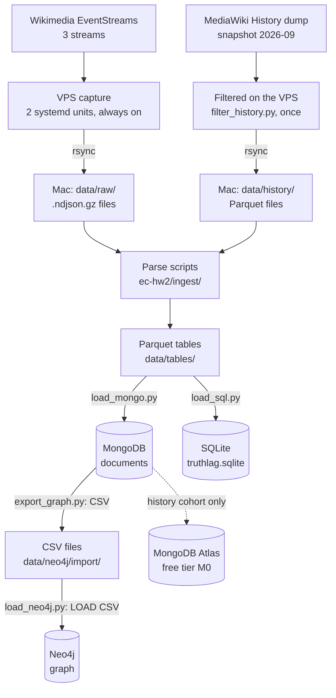

# EC HW2: Truth Lag in MongoDB and Neo4j

> **EC HW2 - NoSQL mini project. Due Thu 2026-10-29 4:29 PM PT. Internal deadline Thu 12:00 PT.**
>
> We study edits on English Wikipedia. We ask which edits get reverted, how fast, and who reverts whom.
> MongoDB holds one document per edit. Neo4j holds a graph of who reverts whom.
> Then we ask the same questions in SQL and compare the three databases.

**Status on 2026-10-24:** the branch `ec-hw2` is on GitHub, with the draft pull request [#1](https://github.com/scottn66/truth-lag/pull/1). The data-v1 release is not published yet, so Ways 2-3 (section 4) need it first. Way 1 (reading on GitHub) works now.

- New words: [GLOSSARY.md](GLOSSARY.md) (with Chinese, 繁體 and 简体).
- Tasks, schedule and daily log: [PROGRESS.md](PROGRESS.md).
- The assignment: [SPEC.md](SPEC.md). Every table and column: [DATA_MODEL.md](DATA_MODEL.md). Writing rules: [STYLE.md](STYLE.md).

**On this page**
1. [Where the data comes from](#1-where-the-data-comes-from)
2. [Two cohorts](#2-two-cohorts)
3. [Your role](#3-your-role)
4. [Three ways to check your part](#4-three-ways-to-check-your-part)
5. [GitHub without Git (6 steps)](#5-github-without-git-6-steps)
6. [How to run everything (Scott's Mac)](#6-how-to-run-everything-scotts-mac)
7. [Safety rules](#7-safety-rules)
8. [Status](#8-status)

---

## 1. Where the data comes from



The same steps in words (for phones that do not show the picture):
1. On the VPS, 2 systemd units read 3 Wikimedia EventStreams all the time. They save every event in `.ndjson.gz` files.
2. On the VPS, `filter_history.py` cut the September 2026 History dump down to the rows we need. This ran once.
3. `rsync` copies both to Scott's Mac, into `data/raw/` and `data/history/`.
4. The parse scripts in `ec-hw2/ingest/` turn them into Parquet tables in `data/tables/`.
5. `load_mongo.py` loads the tables into MongoDB, with one document per revision.
6. `export_graph.py` exports CSV files from MongoDB. `load_neo4j.py` loads them into Neo4j.
7. `load_sql.py` loads the same history tables into SQLite, for the comparison.

Kafka and Spark are for the final project. HW2 does not use them.
Nobody connects to EventStreams from a laptop. The live data comes only from the VPS, by rsync.

---

## 2. Two cohorts

A **cohort** is one group of revisions that we study together.

| | history cohort | live cohort |
|---|---|---|
| Edits made (UTC) | 2026-09-08 to 2026-09-10 | 2026-10-20 to 2026-10-22 |
| Source | MediaWiki History dump, snapshot 2026-09 | Wikimedia EventStreams, captured on the VPS |
| "Reverted" means | reverted within 20 days | reverted within 4 days |
| Labels are final | now | after Mon 2026-10-26 5:05 PM PT (2026-10-27 00:05 UTC) |
| Size | 300,564 rows in the filtered file (raw file, before clean-up). After our filters: `history_revisions` in report/FACTS.md (FINAL) | `live_revisions` in report/FACTS.md (PROVISIONAL until 2026-10-27 00:05 UTC) |
| In `config.py` | `HISTORY_WINDOW` = [2026-09-08, 2026-09-11) | `LIVE_WINDOW` = [2026-10-20, 2026-10-23) |

**Why two cohorts?** The October dump only comes out in November, after our deadline.
So October edits have no dump labels yet.
We take dump labels from September edits, and stream labels from October edits.
A small case study (late reverts) links the two: September edits that were reverted in October.

---

## 3. Your role

There are 4 roles. Owners are not chosen yet: **claim one in the group chat by Sat 2026-10-24 12:00 PT.**
Claude Code built the first version of every file. Each owner checks it, makes the UI items and writes in their own words.

"Verify" means: open the notebook or file, check its numbers against `report/FACTS.md`, then approve the pull request and list the numbers you checked.

| Role | 1. Verify | 2. Make in a UI and upload yourself | 3. Write in your own words | You only need these files |
|---|---|---|---|---|
| **Data+MongoDB** | Notebooks 01 and 02, and the Atlas load | Atlas screenshots, Mongo Q1-Q4 run in Data Explorer, and Mongo Q5 on the local MongoDB | "Data + links", the Mongo section, and "Answer to RQ1" | [notebooks/01_data.ipynb](notebooks/01_data.ipynb)<br>[notebooks/02_mongodb.ipynb](notebooks/02_mongodb.ipynb)<br>[queries/mongo/](queries/mongo/) (`*.json`)<br>[guides/ATLAS_SETUP.md](guides/ATLAS_SETUP.md)<br>[report/FACTS.md](report/FACTS.md) |
| **Neo4j** | Notebook 03 | Neo4j Browser screenshots | The Neo4j section, and "Answer to RQ2" | [notebooks/03_neo4j.ipynb](notebooks/03_neo4j.ipynb)<br>[queries/cypher/](queries/cypher/) (`*.cypher`)<br>[guides/NEO4J_SCREENSHOTS.md](guides/NEO4J_SCREENSHOTS.md)<br>[report/FACTS.md](report/FACTS.md) |
| **Comparison+viz** | Notebooks 04 and 05, the sharding demo, and the Charts | 2 or more Atlas Charts, saved as PNG | Comparison top 5 (re-score the draft modeling-pain scores in `comparison/pain.csv`), and Impact | [notebooks/04_comparison.ipynb](notebooks/04_comparison.ipynb)<br>[notebooks/05_truth_lag.ipynb](notebooks/05_truth_lag.ipynb)<br>[queries/sql/](queries/sql/) (`*.sql`)<br>[guides/ATLAS_CHARTS.md](guides/ATLAS_CHARTS.md)<br>[scaleout/SHARDING.md](scaleout/SHARDING.md)<br>[report/FACTS.md](report/FACTS.md) |
| **Report+GenAI** | README, glossary, report skeleton, criteria map | The final PDF (from the Google Doc) | Abstract, Motivation + related work, Architecture caption + walkthrough, Technical difficulties, Key learnings, Reuse note | [report/REPORT_SKELETON.md](report/REPORT_SKELETON.md)<br>[report/FACTS.md](report/FACTS.md)<br>[report/references.md](report/references.md)<br>[GLOSSARY.md](GLOSSARY.md)<br>[PROGRESS.md](PROGRESS.md)<br>[genai/prompts/](genai/prompts/) |

**Every role also does items 4 and 5:**
- 4\. Literature: read your batch in [report/references.md](report/references.md) (section "Reading batches", about 5 papers). Open each DOI. Write 1-2 sentences per paper in your own words.
- 5\. Add your own row to the GenAI table, and 2-3 dated notes under your role in [PROGRESS.md](PROGRESS.md) ("Personal observations").

Why you upload your UI items yourself: then the GitHub history shows your name on your work.

Every file and folder in this table exists (checked again 2026-10-24 09:50 UTC). The UI items (screenshots, Atlas Charts) are added by their owners.

---

## 4. Three ways to check your part

Pick the way that fits your computer. Way 1 is enough to start.

### Way 1: Read only, on GitHub (no install)
1. Open https://github.com/scottn66/truth-lag and switch the branch menu to `ec-hw2`.
2. Open the folder `ec-hw2/notebooks/` and click your notebook.
3. You should see the code and its results. The outputs are saved in the notebook, so you do not need to run anything.

### Way 2: With a free app and no Python
**MongoDB, in Atlas Data Explorer** (you need the Atlas invite, see [guides/ATLAS_SETUP.md](guides/ATLAS_SETUP.md)):
1. Log in at https://cloud.mongodb.com and open the cluster. Click "Browse Collections".
2. Open the database `truthlag` and the collection named in the `"collection"` field of the query file.
3. Open the "Aggregations" tab and switch it to text mode.
4. Paste the `"pipeline"` list from a file in [queries/mongo/](queries/mongo/), for example `q1_revert_rate_by_hour.json`. The `"description"` field in each file says how.
5. You should see the result rows on the right. Compare them with notebook 02.

Atlas holds the **history cohort only** (without the `comment` field), so live rows are empty there.

**Neo4j, in Neo4j Desktop** (free, https://neo4j.com/download/):
1. Create a local database and set a password.
2. In the Plugins tab, install **APOC** and **Graph Data Science**.
3. On a Mac only: in the database settings, add this line, then save:
   `server.jvm.additional=-Djol.skipHotspotSAAttach=true`
4. Start the database. Copy the 4 CSV files from the data release (`editors.csv`, `pages.csv`, `edited.csv`, `reverted.csv`) into its `import` folder.
5. Open Neo4j Browser. Run [queries/cypher/load.cypher](queries/cypher/load.cypher). Follow the note at its top: some statements need `:auto` in front.
6. Run the query files `q1_...cypher` to `q5_...cypher`. You should see the same rows as in notebook 03.

**SQL, in DB Browser for SQLite** (free, https://sqlitebrowser.org/):
1. Click "Open Database Read Only" and choose `data/tables/truthlag.sqlite` from the data release.
2. Open the "Execute SQL" tab and paste a file from [queries/sql/](queries/sql/), for example `compare_top_contested.sql`.
3. Press the Execute button (Ctrl+Return on Windows, Cmd+Return on Mac).
4. You should see 20 rows. Compare them with [results/sql_compare_top_contested.md](results/sql_compare_top_contested.md).

### Way 3: With Python
Run these in a terminal, from the repo folder. On a Mac use Terminal. On Windows use PowerShell.

| Step | Mac | Windows |
|---|---|---|
| 1. Get the code | GitHub > branch `ec-hw2` > green "Code" button > "Download ZIP", then unzip. Or: `git clone -b ec-hw2 https://github.com/scottn66/truth-lag.git` | the same |
| 2. Go to the folder | `cd truth-lag` | `cd truth-lag` |
| 3. Make a venv (Python 3.12) | `python3.12 -m venv .venv` | `py -3.12 -m venv .venv` |
| 4. Turn the venv on | `source .venv/bin/activate` | `.venv\Scripts\Activate.ps1` |
| 5. Install the packages | `pip install -r ec-hw2/requirements.txt` | `pip install -r ec-hw2\requirements.txt` |
| 6. Make your `.env` | `cp ec-hw2/.env.example ec-hw2/.env` | `copy ec-hw2\.env.example ec-hw2\.env` |
| 7. Get the data | Download the data release files into `data/` exactly (see the folder list below) | the same |
| 8. Check your setup | `python ec-hw2/check_setup.py` | `python ec-hw2\check_setup.py` |
| 9. Open the notebooks | `jupyter lab` | `jupyter lab` |

What you should see:
- Step 1: if you used the ZIP, the folder is called `truth-lag-ec-hw2`. Use that name in step 2.
- Step 3: you need Python 3.12 from https://www.python.org. On Windows, tick "Add python.exe to PATH" when you install it.
- Step 4: your prompt starts with `(.venv)`. On Windows, if PowerShell blocks the script, run `Set-ExecutionPolicy -Scope CurrentUser RemoteSigned` once, then try again.
- Step 5: the last line says `Successfully installed ...`. This takes a few minutes.
- Step 6: open `ec-hw2/.env` in a text editor and fill in what you need (Atlas: ask the Data+MongoDB owner). Never commit this file.
- Step 8: one line per check, each starting with `OK`, `FAIL` or `SKIP`. A FAIL is only a problem if you need that part. If you need help, paste all lines into the group chat.
- Step 9: a browser tab opens. Go to `ec-hw2/notebooks/` and open your notebook.

**Data release.** The data-v1 release is not published yet; its exact files are the folder list below. TODO(after release): add the link here.
Put the files exactly here (the folder names matter):
```
truth-lag/
  data/
    tables/
      DATA_VERSION
      history_revisions.parquet
      history_revert_links.parquet
      live_revisions.parquet
      live_revert_links.parquet
      late_reverts.parquet
      truthlag.sqlite
    neo4j/
      import/
        editors.csv
        pages.csv
        edited.csv
        reverted.csv
```

---

## 5. GitHub without Git (6 steps)

1. Accept the invite at https://github.com/scottn66/truth-lag/invitations.
2. Switch the branch menu (top left, it says `main`) to `ec-hw2`.
3. Open a notebook in `ec-hw2/notebooks/` to read the results.
4. To comment, use the pull request's "Conversation" tab. Or send the comment in the group chat.
5. To review: "Files changed" > "Review changes" > "Approve". In the text box, list the numbers you checked.
6. To upload your screenshots and PNGs: open `ec-hw2/results/figures/` on branch `ec-hw2`, then "Add file" > "Upload files".

Rules:
- Never commit `.env` or any data file.
- Commit only the notebook you own.
- Screenshots and figures show human editors only as pseudonyms, such as `editor_7f3a2b1c9d` (`editor_` + 10 hex digits). Bots keep their real names. Page titles are fine.

---

## 6. How to run everything (Scott's Mac)

Run every command from the repo folder: `cd ~/Desktop/226/truth-lag`.

1. Start the Docker machine:
   ```
   colima start
   ```
   You should see `done` at the end. (The first time ever: `colima start --cpus 4 --memory 6 --disk 20`.)
2. Start MongoDB and Neo4j:
   ```
   docker compose -f ec-hw2/docker-compose.yml --env-file ec-hw2/.env up -d
   ```
   You should see `truthlag-mongo-1` and `truthlag-neo4j-1` as `Started` or `Running`. Check with `docker ps`.
3. Copy the newest data from the VPS. **Never add `--delete`.** The raw files cannot be downloaded again.
   ```
   rsync -az --partial vps-coin:/opt/truthlag/data/raw/ data/raw/
   rsync -az --partial --exclude '*.bz2' --exclude '*.tsv.gz' vps-coin:/opt/truthlag/data/history/ data/history/
   ```
   You should see no output and no error. The history files are already copied; run the second line only if they are lost.
4. Run the pipeline, in this order. Each script prints its row counts and writes a `_SUCCESS_<step>.json` file.
   1. `.venv/bin/python ec-hw2/ingest/parse_history.py`: the history cohort into `data/tables/history_*.parquet`. You should see the number of revisions in `history_revisions` (report/FACTS.md).
   2. `.venv/bin/python ec-hw2/ingest/parse_stream.py`: the raw events into `data/parsed/*.parquet`.
   3. `.venv/bin/python ec-hw2/ingest/label_live.py`: the live cohort and its labels into `data/tables/live_*.parquet`. Before 2026-10-27 00:05 UTC it warns that the labels are PROVISIONAL.
   4. `.venv/bin/python ec-hw2/ingest/late_reverts.py`: the late-revert case study into `data/tables/late_reverts.parquet`.
   5. `.venv/bin/python ec-hw2/load_mongo.py --target local`: both cohorts into the local MongoDB.
   6. `.venv/bin/python ec-hw2/speed_layer.py`: the live counters (`page_hour`) in MongoDB.
   7. `.venv/bin/python ec-hw2/export_graph.py`: CSV files from MongoDB into `data/neo4j/import/`.
   8. `.venv/bin/python ec-hw2/load_neo4j.py --target local`: the graph into Neo4j.
   9. `.venv/bin/python ec-hw2/load_sql.py`: the history cohort into `data/tables/truthlag.sqlite`.
   10. `.venv/bin/python ec-hw2/queries/run_all.py`: all Mongo, Cypher and SQL queries; results go to `ec-hw2/results/`.
   11. `.venv/bin/python ec-hw2/comparison/compare.py`: the 3-engine comparison. Add `--final` only on an idle Mac, after every fix is in. With `--final` the script stops if the Mac is busy (the 1-minute load average is too high).
   12. The facts, the charts, the report skeleton, the numbers in the notebook text, and the 5 notebooks (about 2 minutes; MongoDB and Neo4j must run):
       ```
       .venv/bin/python ec-hw2/report/build_facts.py
       .venv/bin/python ec-hw2/report/make_figures.py
       .venv/bin/python ec-hw2/report/build_skeleton.py
       .venv/bin/python ec-hw2/report/sync_notebook_text.py
       for nb in 01_data 02_mongodb 03_neo4j 04_comparison 05_truth_lag; do .venv/bin/jupyter nbconvert --to notebook --execute --inplace ec-hw2/notebooks/$nb.ipynb; done
       ```
       You should see:
       - `wrote ec-hw2/report/FACTS.md: ... facts`
       - one `wrote ...png` line per figure
       - `wrote ec-hw2/report/REPORT_SKELETON.docx`
       - one `... fact markers, ... values changed` line per notebook
       - one `Writing ... bytes to ec-hw2/notebooks/...` line per notebook.
       The last cell of each notebook prints `OK: all ... numbers match FACTS.md` and `OK: all ... numbers in the text match FACTS.md`.
   13. Atlas (needs `ATLAS_URI` with the write user, in `ec-hw2/.env.atlas` or `ec-hw2/.env`; see [guides/ATLAS_SETUP.md](guides/ATLAS_SETUP.md)):
       ```
       .venv/bin/python ec-hw2/load_mongo.py --target atlas --estimate-only
       .venv/bin/python ec-hw2/load_mongo.py --target atlas --confirm-overwrite
       .venv/bin/python ec-hw2/queries/run_mongo.py --target atlas
       ```
       You should see:
       - `estimated total ... MB; budget 400 MB ... -> fits` (the estimate is `atlas_estimate_mb` in report/FACTS.md)
       - on Atlas: `history_revisions` revisions and `history_revert_links` revert links (history cohort only, without `comment`), and the 4 chart collections.
   14. The sharding demo (about 5 minutes; details in [scaleout/SHARDING.md](scaleout/SHARDING.md), section 4):
       ```
       docker stop truthlag-neo4j-1
       docker compose -f ec-hw2/scaleout/docker-compose.sharded.yml up -d
       bash ec-hw2/scaleout/init_sharded.sh
       .venv/bin/python ec-hw2/scaleout/demo_sharding.py
       docker start truthlag-neo4j-1
       docker compose -f ec-hw2/scaleout/docker-compose.sharded.yml stop
       ```
       You should see:
       - `copied ... history documents` (`shard_documents` in report/FACTS.md)
       - one `check: OK` line per check (`shard_checks_ok`)
       - `wrote .../ec-hw2/results/sharding.md`, with about 50% of the documents on each shard.
       Use `stop`, never `down -v`.
   - **Row counts to check after each step.** Every flag above exists in the script (checked 2026-10-24). Each step writes its counts into a `_SUCCESS` file. The same numbers are in report/FACTS.md, under these keys:
     - Step 1: `data/tables/_SUCCESS_history.json`. Keys `history_revisions`, `history_revert_links`.
     - Step 2: `data/parsed/_SUCCESS_parsed.json`. Keys `capture_page_change_events`, `capture_revert_risk_events`, `capture_tags_events`.
     - Step 3: `data/tables/_SUCCESS_live.json`. Keys `live_revisions`, `live_reverted_4d` (the live revert links).
     - Step 4: `data/tables/_SUCCESS_late_reverts.json`. Key `late_reverts_rows`.
     - Step 5: `data/tables/_SUCCESS_mongo_local.json`. Keys `mongo_revisions_docs`, `mongo_revert_links_docs`, `mongo_tag_events_docs`, `mongo_late_reverts_docs`.
     - Step 6: `data/tables/_SUCCESS_page_hour.json`. Key `mongo_page_hour_docs`.
     - Step 7: `data/neo4j/import/_SUCCESS_export_graph.json`. Step 8: `data/neo4j/_SUCCESS_load_neo4j_local.json`. Keys `neo4j_editor_count`, `neo4j_page_count`, `neo4j_edited_count`, `neo4j_reverted_count`.
     - Step 9: `data/tables/_SUCCESS_sqlite.json`. The same counts as step 1 (`history_revisions`, `history_revert_links`).
     - Step 10: `ec-hw2/results/_SUCCESS_mongo_queries.json`, `_SUCCESS_cypher_queries.json`, `_SUCCESS_sql_queries.json`.
     - Step 11: `ec-hw2/results/_SUCCESS_comparison.json`. Keys `cmp_rows_*` and `cmp_all_identical` (it must be `yes`).
     - Step 13: `data/tables/_SUCCESS_mongo_atlas.json`. Step 14: `ec-hw2/results/_SUCCESS_sharding.json`.
   - The live counts change after each rsync, until the live refresh. They can also fall after a rule fix (for example, the late-revert count fell after the 2026-10-24 range-cover fix).
5. After Mon 2026-10-26 5:05 PM PT (2026-10-27 00:05 UTC), refresh the live cohort:
   ```
   bash ec-hw2/refresh_live.sh
   ```
   It copies the newest raw data, rebuilds the live tables, reloads MongoDB, re-runs the queries and runs the comparison again (draft timing).
   Before the cutoff it stops; `bash ec-hw2/refresh_live.sh --force` refreshes anyway (the live numbers stay PROVISIONAL). At the end it lists every number in `report/FACTS.md` that changed. Then pack the data for the team: `bash ec-hw2/release_data.sh`.

Stop the databases with `docker compose -f ec-hw2/docker-compose.yml --env-file ec-hw2/.env stop`. **Never** use `down -v`.

---

## 7. Safety rules

These rules are for everyone, including AI tools. The full list is in [STYLE.md](STYLE.md).
- Never stop, restart or change the capture on the VPS (`truthlag-capture-a`, `truthlag-capture-b`).
- Never open Wikimedia EventStreams connections from your laptop. The VPS needs both connection slots.
- Never use `rsync --delete`. The raw stream files cannot be downloaded again.
- Never run `docker compose down -v`, because it deletes the databases.
- Never commit `ec-hw2/.env` or anything in `data/`.
- Do not use the `timeout` command; it does not exist on macOS.

---

## 8. Status

See [PROGRESS.md](PROGRESS.md): the schedule, the checklist for each role, "who did what" and the daily log.

**Folders in `ec-hw2/`**
| Folder or file | What is in it |
|---|---|
| `config.py` | Every path, time window and rule. Change a rule here only. |
| `ingest/` | The parse scripts. See [ingest/README.md](ingest/README.md). |
| `queries/` | The query files: `mongo/`, `cypher/`, `sql/`. |
| `notebooks/` | Notebooks 01 to 05, with saved outputs. |
| `results/` | Small query results and figures (committed). |
| `report/` | The report skeleton, `FACTS.md` and `references.md`. |
| `guides/` | Click-by-click guides for Atlas, Atlas Charts and Neo4j screenshots. |
| `scaleout/` | The sharding demo and `SHARDING.md`. |
| `genai/` | The exact prompts given to Claude Code (for the GenAI section). |
