# EC HW2 report skeleton: Truth Lag in MongoDB and Neo4j (Group 9)

> **This is a frame, not the report.** It has no narrative paragraphs on purpose: our proposal lost points because it read as AI-written. Every sentence of the report is written by a team member, in their own words.
>
> **How to use it**
> 1. Sun 2026-10-25: the Report+GenAI owner imports `report/REPORT_SKELETON.docx` into Google Docs. From then on, the Google Doc is the master copy.
> 2. Each section has: the owner role, a word target, a facts box (keys from `report/FACTS.md`, with FINAL or PROVISIONAL), figure files, 3 guiding questions and an `[OWNER: ...]` line. Replace the `[OWNER: ...]` line with your text. Delete the questions when you are done.
> 3. Parts tagged `[drafted by Claude Code; checked by <name>, <date>]` are mechanical drafts (links, tables, query code, result rows). Check each one against the files, then put your name and the date in the tag.
> 4. Numbers marked PROVISIONAL change after the live refresh (after Mon 2026-10-26 5:05 PM PT, which is 2026-10-27 00:05 UTC). Copy them again from `report/FACTS.md` on Tue 2026-10-27.
> 5. Before you submit, search the Google Doc for `[OWNER`, `<name>`, `TODO` and `PROVISIONAL`.
>
> Section headings below are the spec section 7 headings, word for word and in order. Owners are roles; write names in the "Who did what" table at the end.

*Built by `ec-hw2/report/build_skeleton.py` on 2026-10-24 10:30 UTC from `report/FACTS.md` (data-v1). Live cohort: **PROVISIONAL** until 2026-10-27 00:05 UTC.*

## Abstract

**Owner:** Report+GenAI. **Words:** about 150.

**Facts box**

| key                               | value   | unit                                | status      |
|-----------------------------------|---------|-------------------------------------|-------------|
| `history_revisions`               | 295,016 | revisions                           | FINAL       |
| `live_revisions`                  | 279,466 | revisions                           | PROVISIONAL |
| `history_revert_rate_non_bot_pct` | 7.43    | % (reverted within 20 days)         | FINAL       |
| `history_median_T_h`              | 1.02    | h (history reverts within 20 days)  | FINAL       |
| `history_T_within_1h_pct`         | 49.86   | % of history reverts within 20 days | FINAL       |
| `history_T_within_1d_pct`         | 79.68   | % of history reverts within 20 days | FINAL       |
| `cypher_q1_mutual_pairs`          | 462     | pairs                               | FINAL       |
| `mongo_q5_history_known_1h_pct`   | 55.66   | % of 4-day reverts                  | FINAL       |
| `cmp_all_identical`               | yes     |                                     | FINAL       |

**Figures:** none.

**Guiding questions**
1. What question do we answer, and on which data (two cohorts, which dates)?
2. Which 2 or 3 numbers should a reader remember?
3. What did we learn from asking the same questions in MongoDB, Neo4j and SQL?

[OWNER: write 3-6 short sentences (about 150 words) in your own words. Use 2-3 numbers from the facts box. Write it last, after the other sections.]

## Motivation

**Owner:** Report+GenAI. **Words:** about 400 (example 150, related work 250), plus Novelty about 150.

**Hint:** start from our own example page and its revert timeline (below). Then write half a page of related work from `report/references.md`.

**Facts box**

| key                            | value                                                                                                                                                                                                                                         | unit                                | status   |
|--------------------------------|-----------------------------------------------------------------------------------------------------------------------------------------------------------------------------------------------------------------------------------------------|-------------------------------------|----------|
| `example_slow_page_title`      | World_Figure_Skating_Championships                                                                                                                                                                                                            |                                     | FINAL    |
| `example_slow_edits`           | 12                                                                                                                                                                                                                                            | revisions (history cohort)          | FINAL    |
| `example_slow_reverted`        | 9                                                                                                                                                                                                                                             | revisions reverted within 20 d      | FINAL    |
| `example_slow_editor_kinds`    | registered 12                                                                                                                                                                                                                                 | revisions per user kind             | FINAL    |
| `example_slow_first_edit_utc`  | 2026-09-08 04:36 UTC                                                                                                                                                                                                                          |                                     | FINAL    |
| `example_slow_last_revert_utc` | 2026-09-09 19:52 UTC                                                                                                                                                                                                                          |                                     | FINAL    |
| `example_slow_span_h`          | 39.3                                                                                                                                                                                                                                          | h (first edit to last revert)       | FINAL    |
| `example_slow_T_min_s`         | 358                                                                                                                                                                                                                                           | s                                   | FINAL    |
| `example_slow_T_median_s`      | 10,268                                                                                                                                                                                                                                        | s                                   | FINAL    |
| `example_slow_T_max_s`         | 48,397                                                                                                                                                                                                                                        | s                                   | FINAL    |
| `example_slow_first_steps`     | 2026-09-08 04:36 UTC editor_bdbff746bb -17 bytes, reverted after 4.0 h; 2026-09-08 08:37 UTC editor_4e584fa272 +17 bytes (a revert), reverted after 13.4 h; 2026-09-08 22:04 UTC editor_bdbff746bb -17 bytes (a revert), reverted after 2.9 h | timeline (pseudonyms)               | FINAL    |
| `example_fast_page_title`      | Pendulum                                                                                                                                                                                                                                      |                                     | FINAL    |
| `example_fast_edits`           | 20                                                                                                                                                                                                                                            | revisions (history cohort)          | FINAL    |
| `example_fast_reverted`        | 11                                                                                                                                                                                                                                            | revisions reverted within 20 d      | FINAL    |
| `example_fast_editor_kinds`    | temporary 10, registered 8, bot 2                                                                                                                                                                                                             | revisions per user kind             | FINAL    |
| `example_fast_T_median_s`      | 27                                                                                                                                                                                                                                            | s                                   | FINAL    |
| `example_fast_T_max_s`         | 1,097                                                                                                                                                                                                                                         | s                                   | FINAL    |
| `history_T_within_1h_pct`      | 49.86                                                                                                                                                                                                                                         | % of history reverts within 20 days | FINAL    |
| `history_T_over_7d_pct`        | 6.32                                                                                                                                                                                                                                          | % of history reverts within 20 days | FINAL    |

**The example page, step by step** (history cohort; human editors as pseudonyms; full table in notebook 01) `[drafted by Claude Code; checked by <name>, <date>]`

Page `World_Figure_Skating_Championships` (page id 229356):

| time_utc            | editor            | editor_kind   | size_delta   | is_revert   | reverted_20d   | time_to_revert   | reverted_by       |
|---------------------|-------------------|---------------|--------------|-------------|----------------|------------------|-------------------|
| 2026-09-08 04:36:46 | editor_bdbff746bb | registered    | -17          | False       | True           | 4.0 h            | editor_4e584fa272 |
| 2026-09-08 08:37:38 | editor_4e584fa272 | registered    | 17           | True        | True           | 13.4 h           | editor_bdbff746bb |
| 2026-09-08 22:04:15 | editor_bdbff746bb | registered    | -17          | True        | True           | 2.9 h            | editor_4e584fa272 |
| 2026-09-09 00:55:23 | editor_4e584fa272 | registered    | 17           | True        | True           | 1.7 h            | editor_bdbff746bb |
| 2026-09-09 02:38:26 | editor_bdbff746bb | registered    | -17          | True        | True           | 6.0 h            | editor_e4bedc6ef4 |
| 2026-09-09 08:38:58 | editor_e4bedc6ef4 | registered    | 17           | True        | True           | 2.8 h            | editor_bdbff746bb |
| 2026-09-09 11:27:42 | editor_bdbff746bb | registered    | -17          | True        | True           | 2.3 h            | editor_e4bedc6ef4 |
| 2026-09-09 13:46:44 | editor_e4bedc6ef4 | registered    | 17           | True        | True           | 6.0 h            | editor_bdbff746bb |
| 2026-09-09 19:46:36 | editor_bdbff746bb | registered    | -17          | True        | True           | 6 min            | editor_4e584fa272 |
| 2026-09-09 19:52:34 | editor_4e584fa272 | registered    | 17           | True        | False          |                  |                   |
| 2026-09-09 21:40:43 | editor_b73890917c | registered    | -3           | False       | False          |                  |                   |
| 2026-09-10 08:14:47 | editor_7ab1ba1a10 | registered    | 57           | False       | False          |                  |                   |

**Numbers from earlier studies to put next to ours** (from `report/references.md`, "Numbers to compare with ours") `[drafted by Claude Code; checked by <name>, <date>]`

| Paper | Their number | Data | Our number (FACTS key) |
|---|---|---|---|
| Viégas et al. 2004 [1] | median survival time (until the next change): 90.4 min for all content; 2.8 min only for the 3,574 mass deletions (vandalism) | May 2003 history | `history_median_T_h` (compare with the 90.4 min) |
| Buriol et al. 2006 [2] | about 70% of reverts within 1 hour | history to 2006-04 | `history_T_within_1h_pct` |
| Kittur et al. 2007 [6] | median survival of MD5 reverts: 9.7 min | 2006-07-02 dump | `history_median_T_h` |
| Halfaker & Riedl 2012 [13] (magazine column) | bots and tools remove most vandalism before readers see it | qualitative | `mongo_q4_made_by_bot_pct`, `mongo_q3_history_lt_1min_pct` |

Limits of this comparison (from `report/references.md`): [1] and [6] measure survival time, not time to revert. Our T counts only reverts within 20 days (`config.HISTORY_FOLLOWUP_DAYS`); [2] and [6] have no such limit. Their data is from 2003-2006.

**Guiding questions**
1. What did you see on the example page, and why would a reader or a tool that copies Wikipedia care?
2. What did earlier studies measure ([1], [2], [6], [13], [P3]), and what did they not measure?
3. Why is it a problem that the record of an edit (reverted or not) is only final days or weeks later?

[OWNER: write 3-6 short sentences about the example page, in your own words. Then write the related work (about 250 words) with citations [1]-[23] (the number [16] is not used) and [P1]-[P3] from report/references.md.]

### Novelty

**Owner:** Report+GenAI. **Hint:** a search-method sentence, the gap table, and 2 of our own numbers.

[OWNER: write ONE sentence on how we found the papers, as it really happened (it was not a keyword search): a candidate list suggested by an AI tool (Claude Code), plus the reference lists of the papers we read ("snowballing"); each paper was checked on Crossref and its abstract or full text was read (Semantic Scholar, OpenAlex or the publisher), on 2026-10-24 UTC. We screened 35 new papers and kept 22 (21 peer-reviewed papers and 1 magazine column). See report/references.md, "How we found and checked the papers".]

**Gap table** (copied from `report/references.md`) `[drafted by Claude Code; checked by <name>, <date>]`

| Work | Uses a live stream? | Uses dump labels? | Measures time to revert? | Compares the live view with the later record? | Builds a revert graph? | Compares document vs graph databases? |
|---|---|---|---|---|---|---|
| Viégas et al. 2004 [1] | No (May 2003 copy of the history) | No (own text-change analysis) | Partly (survival time until the next change; all content median 90.4 min, mass deletions median 2.8 min) | No | No | No |
| Buriol et al. 2006 [2] | No (history up to 2006-04) | No ("revert"/"rv" in comments) | Partly (about 70% of reverts within 1 h) | No | No (article link graph only) | No |
| Kittur et al. 2007 [6] | No (2006-07-02 dump) | No (own MD5 and comment reverts) | Yes (survival time; MD5 reverts median 9.7 min) | No | Yes (Revert Graph of users) | No |
| Tsvetkova et al. 2017 [14] | No (dumps up to 2010–2011) | No (own text-hash reverts) | Partly (time between successive reverts) | No | Yes (bot-bot revert networks) | No |
| Vicknair et al. 2010 [17] | No | No | No | No | No | Partly (graph vs relational; no document database) |
| Geiger & Halfaker 2013 [P1] | No (looked back at bot downtime in 2011) | unclear | Yes (time to revert "almost doubled" when the bot was down) | Partly (edits missed early "were later eventually reverted") | No | No |
| Trokhymovych et al. 2023 [P2] | No (model trained offline, served on request) | Yes (`revision_is_identity_reverted` from MediaWiki History) | No | No | No | No |
| Halfaker & Geiger 2020 (ORES) [P3] | Yes (precaching listens to a stream of recent edits) | unclear | No (measures scoring time, median 1.1 s) | No | No | No |
| **Our HW2** | **Yes** (`page_change`, revert-risk and tags streams, captured on a VPS) | **Yes** (2026-09 MediaWiki History snapshot) | **Yes** (Mongo Q3, both cohorts) | **Yes** (Mongo Q5, `mw-reverted` vs dump, late-revert case study) | **Yes** (Neo4j `REVERTED`, Cypher Q1–Q5) | **Yes** (MongoDB vs Neo4j vs SQLite) |

[OWNER: write 2-3 sentences: the 3 closest works and what each lacks. Add 2 of our numbers (for example `mongo_q5_history_known_1h_pct` and `late_reverts_rows`). Say that Wikimedia's daily history table is internal and does not measure a consumer's error against the wait time (references.md, facts W13-W16).]

### What we changed after the proposal feedback

`[drafted by Claude Code; checked by <name>, <date>]`

| Proposal item (score) | What we changed | Where to see it |
|---|---|---|
| Motivation (6/10) | Written by a person, starting from our own example page and its revert timeline | Motivation; FACTS keys `example_*`; notebook 01 |
| Literature (7/10) | 22 new sources: 21 peer-reviewed papers and 1 magazine column (the target was 12 or more), each checked by DOI on Crossref | `report/references.md` |
| Novelty (8/10) | The gap table, the search method (an AI-suggested candidate list plus snowballing, each paper checked) and our own numbers | Motivation > Novelty |
| Impact (9/10) | One persona (a RAG-crawler engineer) and the decision table | Results/insights > Impact; notebook 05 |

## Data + links

**Owner:** Data+MongoDB. **Words:** about 150, plus the tables.

**Facts box**

| key                               | value                | unit                      | status      |
|-----------------------------------|----------------------|---------------------------|-------------|
| `history_file_rows`               | 300,564              | rows                      | FINAL       |
| `history_dropped_namespace_not_0` | 4,265                | rows                      | FINAL       |
| `history_dropped_null_same_sha1`  | 568                  | rows                      | FINAL       |
| `history_dropped_null_comment`    | 715                  | rows                      | FINAL       |
| `history_revisions`               | 295,016              | revisions                 | FINAL       |
| `wikistats_content_edits`         | 298,802              | edits                     | FINAL       |
| `history_file_vs_wikistats_pct`   | +0.59                | %                         | FINAL       |
| `live_page_change_events`         | 639,330              | events                    | PROVISIONAL |
| `live_dropped_namespace_not_0`    | 205,504              | events                    | PROVISIONAL |
| `live_dropped_outside_window`     | 133,972              | events                    | PROVISIONAL |
| `live_dropped_not_edit`           | 20,388               | events                    | PROVISIONAL |
| `live_revisions`                  | 279,466              | revisions                 | PROVISIONAL |
| `capture_page_change_first_utc`   | 2026-10-19T23:00:00Z | UTC                       | FINAL       |
| `capture_tags_first_utc`          | 2026-10-17T01:30:18Z | UTC                       | FINAL       |
| `live_newest_meta_dt`             | 2026-10-24T07:59:59Z | UTC (newest parsed event) | PROVISIONAL |
| `live_final_after`                | 2026-10-27T00:05:00Z | UTC                       | FINAL       |

**Figures:**

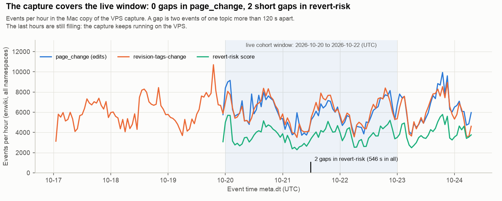

*Figure file: `results/figures/fig_capture_coverage.png`.* [OWNER: write the caption in your own words.]

**Sources** `[drafted by Claude Code; checked by <name>, <date>]`

| Source | Link | Size, dates | License | How we got it |
|---|---|---|---|---|
| MediaWiki History dump, English Wikipedia, snapshot 2026-09 | https://dumps.wikimedia.org/other/mediawiki_history/2026-09/enwiki/2026-09.enwiki.2026-09.tsv.bz2 | 557,344,652 bytes (557 MB, bz2); downloaded 2026-10-24 (UTC) | CC0 (see https://dumps.wikimedia.org/other/mediawiki_history/readme.html) | Downloaded on the VPS and filtered once by `ingest/vps/filter_history.py` (repo root) into 2 Parquet files: the 2026-09-08 to 2026-09-10 namespace-0 cohort and a slim file of all September revisions. Copied to the Mac with rsync. |
| Wikimedia EventStreams: `mediawiki.page_change.v1` | https://stream.wikimedia.org/v2/stream/mediawiki.page_change.v1 | replayed from 2026-10-19 23:00 UTC (the capture unit runs since 2026-10-24 04:52 UTC) | No license is stated; we link the service: https://wikitech.wikimedia.org/wiki/Event_Platform/EventStreams_HTTP_Service | Captured on the VPS by `ingest/vps/capture.py` (unit `truthlag-capture-a`). Copied to the Mac with rsync. No laptop connects to EventStreams. |
| Wikimedia EventStreams: `mediawiki.page_revert_risk_prediction_change.v1` | https://stream.wikimedia.org/v2/stream/mediawiki.page_revert_risk_prediction_change.v1 | replayed from 2026-10-19 23:00 UTC (same unit) | as above | Same connection as page_change (`truthlag-capture-a`). |
| Wikimedia EventStreams: `mediawiki.revision-tags-change` | https://stream.wikimedia.org/v2/stream/mediawiki.revision-tags-change | replayed from 2026-10-17 00:00 UTC (first event 2026-10-17 01:30 UTC; the unit runs since 2026-10-24 04:52 UTC) | as above | Captured on the VPS (`truthlag-capture-b`). |
| Our code | https://github.com/scottn66/truth-lag (branch `ec-hw2`, folder `ec-hw2/`) | | | |

**The two cohorts** `[drafted by Claude Code; checked by <name>, <date>]`

| | history cohort | live cohort |
|---|---|---|
| Edits made (UTC) | 2026-09-08 to 2026-09-10 | 2026-10-20 to 2026-10-22 |
| Source | MediaWiki History dump, snapshot 2026-09 | EventStreams, captured on the VPS |
| "Reverted" means | an identity revert within 20 days (dump label) | the first exact revert that covers the edit, within 4 days (stream label) |
| Revisions | `history_revisions` | `live_revisions` (PROVISIONAL) |
| Labels final | now | after 2026-10-27 00:05 UTC |

### Where we differ from the spec, and why

`[drafted by Claude Code; checked by <name>, <date>]`

| Spec says | We did | Why |
|---|---|---|
| Stream `recentchange` / `revision-create` | `mediawiki.page_change.v1`, plus the revert-risk and tags streams | The replay of revision-create is sparse and has no revert fields. page_change.v1 has `revision.revert` (method, exact or not, the reverted range). |
| One live sample, labelled by the dump of the same window | Two cohorts: history (dump labels) and live (stream labels), plus a small late-revert case study that links them | The 2026-10 dump appears in November, after our deadline (the dumps are monthly). |
| Revert label from the dump | For the live cohort: the stream label (the first exact revert within 4 days) | No October dump exists yet. A 4-day follow-up ends before the live cut-off (2026-10-27 00:05 UTC). |
| (no host given) | The capture runs on a VPS (2 systemd units); the data comes to the Mac by rsync | EventStreams allows 2 connections per IP and replays only about 7 days, so an always-on machine is safer. |
| `(:Editor)-[:REVERTED {ts, count}]->(:Editor)` | REVERTED also has `page_id` (and `n_revisions`, `last_ts`); one relationship per reverter, reverted editor and page | Mutual reverts (Cypher Q1) must be on the same page. |
| Atlas free tier + sharding | Atlas free tier = M0 (512 MB, no sharding). The shard key `{"page.id": "hashed"}` is shown on a local 2-shard Docker cluster. | M0 does not allow sharding; sharding starts at the paid M30 tier. |
| `(:Page)-[:IN_CATEGORY]->(:Category)` (optional) | Skipped | It is optional, the dump has no categories, and Cypher Q1-Q5 do not need them. |
| Neo4j Browser/Bloom screenshots | Neo4j Browser screenshots | Bloom is not part of Neo4j Community Edition. |
| `user.is_anon` | `user.is_anon` = a temporary account | Since 2025-11-04 English Wikipedia has no IP edits; logged-out editors get temporary accounts. |

**Guiding questions**
1. Which two sources do we use, and why do we need two cohorts?
2. Which rows did we drop, and why (namespace, null revisions, window)?
3. How do we know the data is complete (the Wikistats check, the capture gaps)?

[OWNER: write 3-6 short sentences in your own words, around the tables.]

## Architecture/workflow diagram

**Owner:** Report+GenAI. **Words:** about 100.

`[drafted by Claude Code; checked by <name>, <date>]` The picture is made from `report/figures/architecture.mmd` (Mermaid) by `report/make_figures.py`.

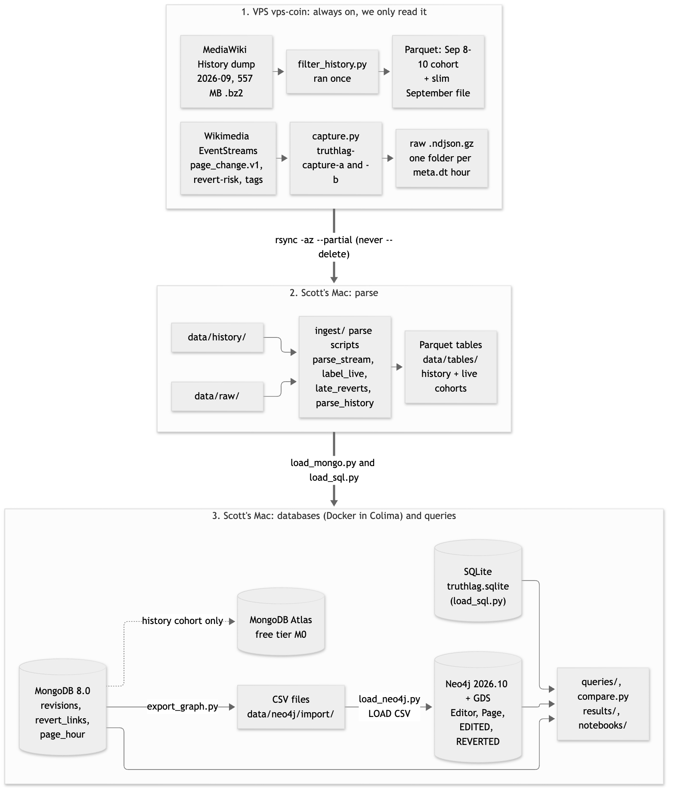

*Figure file: `report/figures/architecture.png`.* [OWNER: write the caption in your own words.]

**Guiding questions**
1. Which steps run on the VPS, which run on the Mac, and why?
2. Where does each database get its data (MongoDB from Parquet, Neo4j from MongoDB's CSV export, SQLite from Parquet)?
3. Which step will change first in the final project (Kafka, Spark)?

[OWNER: write 3-6 short sentences in your own words that walk the reader through the picture.]

## Mongo section

**Owner:** Data+MongoDB. **Words:** about 400, plus the query blocks.

**Facts box**

| key                               | value                                                                                                                                                                                         | unit                                                                      | status      |
|-----------------------------------|-----------------------------------------------------------------------------------------------------------------------------------------------------------------------------------------------|---------------------------------------------------------------------------|-------------|
| `mongo_revisions_docs`            | 574,482                                                                                                                                                                                       | documents                                                                 | PROVISIONAL |
| `mongo_revert_links_docs`         | 37,117                                                                                                                                                                                        | documents                                                                 | PROVISIONAL |
| `mongo_page_hour_docs`            | 299,476                                                                                                                                                                                       | documents                                                                 | PROVISIONAL |
| `mongo_indexes`                   | 7                                                                                                                                                                                             | indexes                                                                   | FINAL       |
| `mongo_index_list`                | revisions.page.id_1_ts_1; revisions.user.id_1; revisions.history.reverted_1; revisions.cohort_1_ts_1; revert_links.reverted_rev_id_1; revert_links.page_id_1; revert_links.cohort_1_page_id_1 |                                                                           | FINAL       |
| `mongo_ms_q1_revert_rate_by_hour` | 5,229.9                                                                                                                                                                                       | ms (median of 7)                                                          | PROVISIONAL |
| `mongo_ms_q2_top_contested_pages` | 78.2                                                                                                                                                                                          | ms (median of 7; single-engine run, not for the comparison: use cmp_ms_*) | FINAL       |
| `mongo_ms_q3_time_to_revert`      | 50.3                                                                                                                                                                                          | ms (median of 7)                                                          | FINAL       |
| `mongo_ms_q4_bot_vs_human`        | 269.5                                                                                                                                                                                         | ms (median of 7)                                                          | FINAL       |
| `mongo_ms_q5_truth_lag_preview`   | 15,147.8                                                                                                                                                                                      | ms (median of 7)                                                          | PROVISIONAL |
| `atlas_estimate_mb`               | 229.7                                                                                                                                                                                         | MB (budget 400, limit 512)                                                | FINAL       |
| `shard_key`                       | {"page.id": "hashed"}                                                                                                                                                                         |                                                                           | FINAL       |
| `shard_shard1rs_pct`              | 49.98                                                                                                                                                                                         | % of documents                                                            | FINAL       |
| `shard_shard2rs_pct`              | 50.02                                                                                                                                                                                         | % of documents                                                            | FINAL       |
| `shard_route_one_page`            | SINGLE_SHARD                                                                                                                                                                                  |                                                                           | FINAL       |
| `shard_route_one_editor`          | SHARD_MERGE                                                                                                                                                                                   |                                                                           | FINAL       |
| `shard_biggest_page_title`        | List_of_2018_albums                                                                                                                                                                           |                                                                           | FINAL       |
| `shard_biggest_page_revisions`    | 261                                                                                                                                                                                           | revisions                                                                 | FINAL       |

**Figures:**

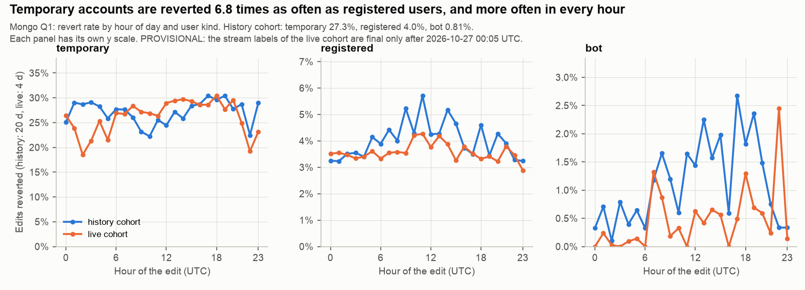

*Figure file: `results/figures/fig_revert_rate_by_hour.png`.* [OWNER: write the caption in your own words.]

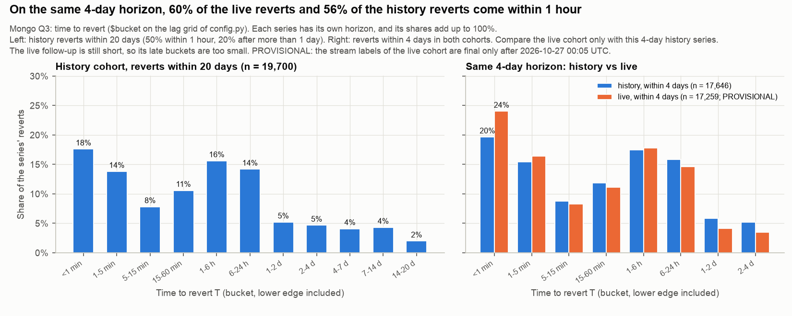

*Figure file: `results/figures/fig_time_to_revert.png`.* [OWNER: write the caption in your own words.]

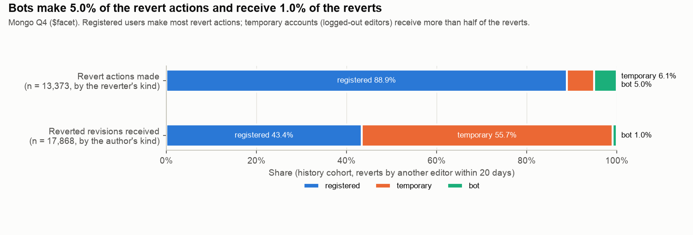

*Figure file: `results/figures/fig_bot_vs_human.png`.* [OWNER: write the caption in your own words.]

*Figure not made yet: `results/figures/chart_q1_hour_kind.png`. Atlas Chart 1, made in the Atlas UI by Comparison+viz (guides/ATLAS_CHARTS.md, part B)*

*Figure not made yet: `results/figures/chart_q3_time_to_revert.png`. Atlas Chart 2, made in the Atlas UI by Comparison+viz (guides/ATLAS_CHARTS.md, part C). The caption must say that the live time to revert is capped at 4 days and censored until 2026-10-27 00:05 UTC, and compare the live cohort only with the history_4d rows.*

**Atlas screenshots** (made in the Atlas UI by Data+MongoDB, `guides/ATLAS_SETUP.md`, part F)

*Figure not made yet: `results/figures/atlas_cluster_m0.png`. The Atlas free-tier cluster card (M0), the evidence for "Atlas free tier"; guides/ATLAS_SETUP.md, step 19*

*Figure not made yet: `results/figures/atlas_indexes.png`. The Indexes tab of revisions on Atlas; guides/ATLAS_SETUP.md, step 21*

*Figure not made yet: `results/figures/atlas_sample_document.png`. One bot document in Data Explorer; guides/ATLAS_SETUP.md, step 20*

*Figure not made yet: `results/figures/atlas_mongo_q1.png`. Mongo Q1 run in Data Explorer > Aggregations; guides/ATLAS_SETUP.md, step 22*

*Figure not made yet: `results/figures/atlas_mongo_q2.png`. Mongo Q2 run in Data Explorer > Aggregations; guides/ATLAS_SETUP.md, step 22*

*Figure not made yet: `results/figures/atlas_mongo_q3.png`. Mongo Q3 run in Data Explorer > Aggregations; guides/ATLAS_SETUP.md, step 22*

*Figure not made yet: `results/figures/atlas_mongo_q4.png`. Mongo Q4 run in Data Explorer > Aggregations; guides/ATLAS_SETUP.md, step 22*

*Figure not made yet: `results/figures/mongo_q5_local.png`. Mongo Q5 run on the local MongoDB (Compass in text view, or the Mongo Q5 output cell of notebook 02 or 05), because Atlas has no live cohort; guides/ATLAS_SETUP.md, step 23*

**One `revisions` document** (history cohort, from `results/sample_documents.json`; the human editor is a pseudonym and the user id is hidden) `[drafted by Claude Code; checked by <name>, <date>]`

```json
{
  "_id": "enwiki:1373795093",
  "wiki_db": "enwiki",
  "rev_id": 1373795093,
  "parent_id": 1373794884,
  "cohort": "history",
  "page": {
    "id": 28116865,
    "title": "Adam_Liaw",
    "ns": 0
  },
  "user": {
    "id": null,
    "name": "editor_ec984595df",
    "kind": "registered",
    "key": "editor_ec984595df",
    "is_bot": false,
    "is_anon": false,
    "is_temp": false,
    "edit_count": 2
  },
  "ts": {
    "$date": "2026-09-08T00:12:14Z"
  },
  "hour_utc": 0,
  "size": 20863,
  "size_delta": 29,
  "comment": "added extra information on how he changed throughout his journey",
  "tags": [
    "visualeditor"
  ],
  "mw_reverted_tag": true,
  "is_revert": false,
  "revert_method": null,
  "history": {
    "snapshot": "2026-09",
    "reverted": true,
    "reverted_any": true,
    "secs_to_revert": 125,
    "reverting_rev_id": 1373795417,
    "reverter": {
      "key": "u:13286072",
      "name": "ClueBot NG",
      "kind": "bot"
    },
    "reverted_by_other": true,
    "followup_s": 1992373,
    "page_edits_prev_1h": 1
  }
}
```

**Query blocks** `[drafted by Claude Code; checked by <name>, <date>]`

**Mongo Q1: revert rate by hour of day and user kind**

Collection `revisions`. File `queries/mongo/q1_revert_rate_by_hour.json`. Median time 5,229.9 ms (median of 7), local MongoDB.

```json
[
    {"$match": {"cohort": "history"}},
    {
      "$project": {
        "_id": 0,
        "cohort": 1,
        "hour_utc": 1,
        "user_kind": "$user.kind",
        "reverted": "$history.reverted"
      }
    },
    {
      "$unionWith": {
        "coll": "revisions",
        "pipeline": [
          {"$match": {"cohort": "live"}},
          {
            "$lookup": {
              "from": "revert_links",
              "localField": "rev_id",
              "foreignField": "reverted_rev_id",
              "let": {"c": "$cohort"},
              "pipeline": [
                {"$match": {"$expr": {"$eq": ["$cohort", "$$c"]}, "within_followup": true}},
                {"$project": {"_id": 0, "T_s": 1}}
              ],
              "as": "link"
            }
          },
          {
            "$project": {
              "_id": 0,
              "cohort": 1,
              "hour_utc": 1,
              "user_kind": "$user.kind",
              "reverted": {"$gt": [{"$size": "$link"}, 0]}
            }
          }
        ]
      }
    },
    {
      "$group": {
        "_id": {"cohort": "$cohort", "hour_utc": "$hour_utc", "user_kind": "$user_kind"},
        "edits": {"$sum": 1},
        "reverted": {"$sum": {"$cond": ["$reverted", 1, 0]}}
      }
    },
    {
      "$project": {
        "_id": 0,
        "cohort": "$_id.cohort",
        "hour_utc": "$_id.hour_utc",
        "user_kind": "$_id.user_kind",
        "edits": 1,
        "reverted": 1,
        "revert_rate": {"$divide": ["$reverted", "$edits"]}
      }
    },
    {"$sort": {"cohort": 1, "hour_utc": 1, "user_kind": 1}}
  ]
```

Result: the first rows (of 147 rows in `results/mongo_q1_revert_rate_by_hour.csv`):

| cohort   | hour_utc   | user_kind   | edits   | reverted   | revert_rate   |
|----------|------------|-------------|---------|------------|---------------|
| history  | 0          | bot         | 2432    | 8          | 0.003289      |
| history  | 0          | registered  | 9669    | 314        | 0.03247       |
| history  | 0          | temporary   | 1298    | 326        | 0.2512        |
| history  | 1          | bot         | 1559    | 11         | 0.007056      |
| history  | 1          | registered  | 8726    | 282        | 0.03232       |
| history  | 1          | temporary   | 1437    | 417        | 0.2902        |
| history  | 2          | bot         | 3900    | 4          | 0.001026      |
| history  | 2          | registered  | 8698    | 305        | 0.03507       |

**Mongo Q2: top 20 contested pages (history cohort)**

Collection `revert_links`. File `queries/mongo/q2_top_contested_pages.json`. Median time 78.2 ms (median of 7; single-engine run, not for the comparison: use cmp_ms_*), local MongoDB.

```json
[
    {"$match": {"cohort": "history", "within_followup": true, "by_other": true}},
    {
      "$group": {
        "_id": "$page_id",
        "actions": {"$addToSet": "$reverting_rev_id"},
        "editors": {"$addToSet": "$author_key"}
      }
    },
    {
      "$project": {
        "revert_actions": {"$size": "$actions"},
        "reverted_editors": {"$size": "$editors"}
      }
    },
    {"$match": {"reverted_editors": {"$gte": 2}}},
    {
      "$lookup": {
        "from": "revisions",
        "localField": "_id",
        "foreignField": "page.id",
        "pipeline": [
          {"$match": {"cohort": "history"}},
          {"$sort": {"ts": 1}},
          {
            "$group": {
              "_id": null,
              "edits": {"$sum": {"$cond": ["$user.is_bot", 0, 1]}},
              "title": {"$last": "$page.title"}
            }
          }
        ],
        "as": "rev"
      }
    },
    {"$unwind": "$rev"},
    {
      "$project": {
        "_id": 0,
        "page_id": "$_id",
        "page_title": "$rev.title",
        "edits": "$rev.edits",
        "revert_actions": 1,
        "reverted_editors": 1
      }
    },
    {"$match": {"edits": {"$gte": 10}}},
    {"$addFields": {"score": {"$divide": ["$revert_actions", "$edits"]}}},
    {"$sort": {"score": -1, "revert_actions": -1, "edits": -1, "page_id": 1}},
    {"$limit": 20},
    {
      "$addFields": {
        "contested": {
          "$and": [
            {"$gte": ["$revert_actions", 2]},
            {"$gte": ["$reverted_editors", 2]},
            {"$gte": ["$score", 0.2]}
          ]
        }
      }
    }
  ]
```

Result: the first rows (of 20 rows in `results/mongo_q2_top_contested_pages.csv`):

| rank   | page_id   | page_title                            | edits   | revert_actions   | reverted_editors   | score   | contested   |
|--------|-----------|---------------------------------------|---------|------------------|--------------------|---------|-------------|
| 1      | 11383948  | Personality_and_image_of_Elizabeth_II | 14      | 13               | 5                  | 0.9286  | True        |
| 2      | 52382     | Watergate_scandal                     | 32      | 28               | 14                 | 0.875   | True        |
| 3      | 3146234   | PB&J_Otter                            | 39      | 34               | 13                 | 0.8718  | True        |
| 4      | 82920850  | Jim_Queen                             | 14      | 12               | 8                  | 0.8571  | True        |
| 5      | 3040638   | Pororo_the_Little_Penguin             | 13      | 11               | 3                  | 0.8462  | True        |
| 6      | 32988783  | Head_shake                            | 11      | 9                | 3                  | 0.8182  | True        |
| 7      | 15903588  | Gabre_Heard                           | 10      | 8                | 4                  | 0.8     | True        |
| 8      | 229356    | World_Figure_Skating_Championships    | 12      | 9                | 3                  | 0.75    | True        |
| 9      | 84135854  | GPT-6                                 | 23      | 17               | 7                  | 0.7391  | True        |
| 10     | 70526372  | Styropyro                             | 14      | 10               | 3                  | 0.7143  | True        |

**Mongo Q3: time to revert (`$bucket`).** The pipeline is long, so it is in the [Appendix: the long Mongo pipelines (Mongo Q3 and Q5)](#appendix-the-long-mongo-pipelines-mongo-q3-and-q5), with its result rows. File `queries/mongo/q3_time_to_revert.json`; results `results/mongo_q3_time_to_revert.md`. Compare the live cohort only with the `history_4d` rows (both 4 days).

**Mongo Q4: bot vs human share of reverts (history cohort)**

Collection `revert_links`. File `queries/mongo/q4_bot_vs_human.json`. Median time 269.5 ms (median of 7), local MongoDB.

```json
[
    {"$match": {"cohort": "history", "within_followup": true, "by_other": true}},
    {
      "$facet": {
        "made_by_reverter_kind": [
          {
            "$group": {
              "_id": {"kind": "$reverter_kind", "rev": "$reverting_rev_id"},
              "links": {"$sum": 1}
            }
          },
          {
            "$group": {
              "_id": "$_id.kind",
              "revert_actions": {"$sum": 1},
              "reverted_revisions": {"$sum": "$links"}
            }
          },
          {"$project": {"_id": 0, "kind": "$_id", "revert_actions": 1, "reverted_revisions": 1}},
          {"$setWindowFields": {"output": {"total": {"$sum": "$revert_actions"}}}},
          {"$addFields": {"share": {"$divide": ["$revert_actions", "$total"]}}},
          {"$project": {"total": 0}},
          {"$sort": {"revert_actions": -1, "kind": 1}}
        ],
        "received_by_author_kind": [
          {
            "$group": {
              "_id": "$author_kind",
              "reverted_revisions": {"$sum": 1},
              "rev_actions": {"$addToSet": "$reverting_rev_id"}
            }
          },
          {
            "$project": {
              "_id": 0,
              "kind": "$_id",
              "reverted_revisions": 1,
              "revert_actions": {"$size": "$rev_actions"}
            }
          },
          {"$setWindowFields": {"output": {"total": {"$sum": "$reverted_revisions"}}}},
          {"$addFields": {"share": {"$divide": ["$reverted_revisions", "$total"]}}},
          {"$project": {"total": 0}},
          {"$sort": {"reverted_revisions": -1, "kind": 1}}
        ],
        "edit_revert_rate": [
          {"$limit": 1},
          {
            "$lookup": {
              "from": "revisions",
              "pipeline": [
                {"$match": {"cohort": "history"}},
                {
                  "$group": {
                    "_id": {"$cond": ["$user.is_bot", "bot", "human"]},
                    "edits": {"$sum": 1},
                    "reverted": {"$sum": {"$cond": ["$history.reverted", 1, 0]}},
                    "reverted_by_other": {
                      "$sum": {
                        "$cond": [
                          {"$and": ["$history.reverted", "$history.reverted_by_other"]},
                          1,
                          0
                        ]
                      }
                    }
                  }
                },
                {
                  "$project": {
                    "_id": 0,
                    "kind": "$_id",
                    "edits": 1,
                    "reverted": 1,
                    "reverted_by_other": 1,
                    "revert_rate": {"$divide": ["$reverted", "$edits"]},
                    "revert_rate_by_other": {"$divide": ["$reverted_by_other", "$edits"]}
                  }
                },
                {"$sort": {"kind": 1}}
              ],
              "as": "rates"
            }
          },
          {"$unwind": "$rates"},
          {"$replaceRoot": {"newRoot": "$rates"}}
        ]
      }
    }
  ]
```

Result: the first rows (of 8 rows in `results/mongo_q4_bot_vs_human.csv`):

| part                    | kind       | revert_actions   | reverted_revisions   | share    | edits     | reverted   | reverted_by_other   | revert_rate   | revert_rate_by_other   |
|-------------------------|------------|------------------|----------------------|----------|-----------|------------|---------------------|---------------|------------------------|
| made_by_reverter_kind   | registered | 1.189e+04        | 1.61e+04             | 0.8888   |           |            |                     |               |                        |
| made_by_reverter_kind   | temporary  | 815              | 1024                 | 0.06094  |           |            |                     |               |                        |
| made_by_reverter_kind   | bot        | 672              | 739                  | 0.05025  |           |            |                     |               |                        |
| received_by_author_kind | temporary  | 7861             | 9946                 | 0.5566   |           |            |                     |               |                        |
| received_by_author_kind | registered | 5563             | 7749                 | 0.4337   |           |            |                     |               |                        |
| received_by_author_kind | bot        | 171              | 173                  | 0.009682 |           |            |                     |               |                        |
| edit_revert_rate        | bot        |                  |                      |          | 3.348e+04 | 271        | 173                 | 0.008094      | 0.005167               |
| edit_revert_rate        | human      |                  |                      |          | 2.615e+05 | 1.943e+04  | 1.77e+04            | 0.07429       | 0.06766                |

**Mongo Q5: the truth-lag preview (`$lookup`).** The pipeline is long, so it is in the [Appendix: the long Mongo pipelines (Mongo Q3 and Q5)](#appendix-the-long-mongo-pipelines-mongo-q3-and-q5), with its result rows. File `queries/mongo/q5_truth_lag_preview.json`; results `results/mongo_q5_truth_lag_preview.md`. The risk-decile pipeline of the Impact decision table is `queries/mongo/q5_risk_deciles.json`.

**Scale-out:** see `scaleout/SHARDING.md` and `results/sharding.md` (the 2-shard demo), and the Atlas screenshots above (Data+MongoDB).

**Guiding questions**
1. Why one document per revision, and which data is embedded (the `history` part) and which is looked up with `$lookup` (`revert_links`)?
2. Which index helps which query, and what does each pipeline stage do?
3. What does the shard key `{"page.id": "hashed"}` do well (one page = one shard) and what not (one editor = every shard)?

[OWNER: write the Mongo section in your own words (about 400 words): the document model, the indexes, the 5 pipelines (1-2 sentences each), the timings, Atlas and the shard key.]

## Neo4j section

**Owner:** Neo4j. **Words:** about 400, plus the query blocks.

**Facts box**

| key                                       | value      | unit                                                                                   | status   |
|-------------------------------------------|------------|----------------------------------------------------------------------------------------|----------|
| `neo4j_editor_count`                      | 37,546     | nodes                                                                                  | FINAL    |
| `neo4j_page_count`                        | 165,415    | nodes                                                                                  | FINAL    |
| `neo4j_edited_count`                      | 295,013    | relationships                                                                          | FINAL    |
| `neo4j_reverted_count`                    | 13,269     | relationships                                                                          | FINAL    |
| `contested_pages_total`                   | 126        | pages                                                                                  | FINAL    |
| `cypher_q1_mutual_pairs`                  | 462        | pairs                                                                                  | FINAL    |
| `cypher_q1_pages`                         | 397        | pages                                                                                  | FINAL    |
| `cypher_q1_pairs_with_bot`                | 25         | pairs                                                                                  | FINAL    |
| `cypher_q2_top_pagerank_editor`           | ClueBot NG | (bot)                                                                                  | FINAL    |
| `cypher_q2_top_pagerank`                  | 87.58      | PageRank score (REVERSE projection, converged after 111 iterations)                    | FINAL    |
| `cypher_q2_top_human_pagerank`            | 38.66      | PageRank score (REVERSE projection, converged after 111 iterations), editor_5d9d202d8d | FINAL    |
| `cypher_q3_louvain_communities`           | 28,615     | communities (all; most are 1 editor with no revert)                                    | FINAL    |
| `cypher_q3_louvain_modularity`            | 0.9142     |                                                                                        | FINAL    |
| `cypher_q3_largest_community_editors`     | 564        | editors                                                                                | FINAL    |
| `cypher_q3_largest_wcc_editors`           | 7,081      | editors                                                                                | FINAL    |
| `cypher_q3_editors_without_revert_pct`    | 73.04      | % of editors                                                                           | FINAL    |
| `cypher_q4_top_page_title`                | PB&J_Otter |                                                                                        | FINAL    |
| `cypher_q4_top_page_warring_editors`      | 10         | editors                                                                                | FINAL    |
| `cypher_q5_top_pair_shared_pages`         | 4          | contested pages                                                                        | FINAL    |
| `cypher_ms_q1_mutual_reverts`             | 53.0       | ms (median of 7; single-engine run, not for the comparison: use cmp_ms_*)              | FINAL    |
| `cypher_ms_q2_central_reverters`          | 193.3      | ms (median of 7)                                                                       | FINAL    |
| `cypher_ms_q3_conflict_communities`       | 106.9      | ms (median of 7)                                                                       | FINAL    |
| `cypher_ms_q4_pages_most_warring_editors` | 26.2       | ms (median of 7)                                                                       | FINAL    |
| `cypher_ms_q5_two_hop_contested`          | 17.9       | ms (median of 7)                                                                       | FINAL    |

**Figures:**

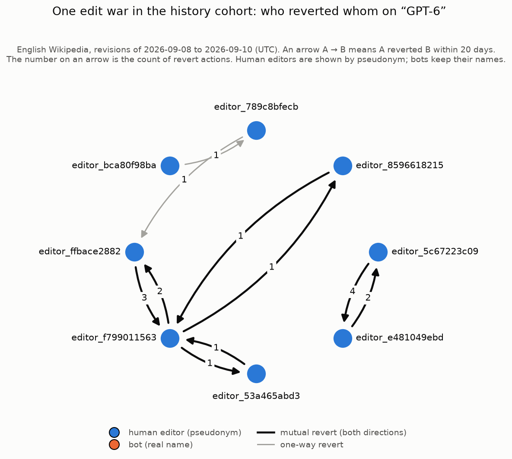

*Figure file: `results/figures/neo4j_edit_war_example.png`.* [OWNER: write the caption in your own words.]

**Neo4j Browser screenshots** (made in Neo4j Browser by the Neo4j owner, `guides/NEO4J_SCREENSHOTS.md`)

*Figure not made yet: `results/figures/neo4j_schema.png`. The graph model, CALL db.schema.visualization(); guides/NEO4J_SCREENSHOTS.md, step 7*

*Figure not made yet: `results/figures/neo4j_mutual_reverts.png`. Mutual-revert pairs (Cypher Q1 as a picture); guides/NEO4J_SCREENSHOTS.md, step 8*

*Figure not made yet: `results/figures/neo4j_contested_page.png`. One contested page with its editors and reverts; guides/NEO4J_SCREENSHOTS.md, step 9*

*Figure not made yet: `results/figures/neo4j_largest_community.png`. The largest Louvain community (a patroller and the editors they reverted); guides/NEO4J_SCREENSHOTS.md, step 10*

*Figure not made yet: `results/figures/neo4j_cypher_q1_table.png`. The Cypher Q1 result table; guides/NEO4J_SCREENSHOTS.md, step 12*

*Figure not made yet: `results/figures/neo4j_cypher_q2_table.png`. The Cypher Q2 result table; guides/NEO4J_SCREENSHOTS.md, step 12*

*Figure not made yet: `results/figures/neo4j_cypher_q3_table.png`. The Cypher Q3 result table; guides/NEO4J_SCREENSHOTS.md, step 12*

*Figure not made yet: `results/figures/neo4j_cypher_q4_table.png`. The Cypher Q4 result table; guides/NEO4J_SCREENSHOTS.md, step 12*

*Figure not made yet: `results/figures/neo4j_cypher_q5_table.png`. The Cypher Q5 result table; guides/NEO4J_SCREENSHOTS.md, step 12*

**Query blocks** `[drafted by Claude Code; checked by <name>, <date>]`

**Cypher Q1 (spec 4.1): mutual-revert pairs on the same page (edit wars)**

File `queries/cypher/q1_mutual_reverts.cypher` (2 statements). Median time of the main result 53.0 ms (median of 7; single-engine run, not for the comparison: use cmp_ms_*), local Neo4j.

```cypher
MATCH (a:Editor)-[r1:REVERTED]->(b:Editor)-[r2:REVERTED]->(a)
WHERE r1.page_id = r2.page_id AND a.key < b.key
MATCH (p:Page {id: r1.page_id})
RETURN p.id AS page_id, p.title AS page_title, a.alias AS editor_a, b.alias AS editor_b,
       r1.count AS a_reverted_b, r2.count AS b_reverted_a
ORDER BY page_id, a.key, b.key;

MATCH (a:Editor)-[r1:REVERTED]->(b:Editor)-[r2:REVERTED]->(a)
WHERE r1.page_id = r2.page_id AND a.key < b.key
WITH count(*) AS mutual_pairs, count(DISTINCT r1.page_id) AS pages,
     count(CASE WHEN a.kind = 'bot' OR b.kind = 'bot' THEN 1 END) AS pairs_with_bot,
     collect(a) + collect(b) AS people
UNWIND people AS e
RETURN mutual_pairs, pages, count(DISTINCT e) AS editors, pairs_with_bot;
```

Result: the first rows (of 462 rows in `results/cypher_q1_mutual_reverts.csv`):

| page_id   | page_title                            | editor_a          | editor_b          | a_reverted_b   | b_reverted_a   |
|-----------|---------------------------------------|-------------------|-------------------|----------------|----------------|
| 1921      | Al-Qaeda                              | editor_9eb8ef10a7 | editor_0d0cfcfbf9 | 1              | 1              |
| 6443      | Ceuta                                 | editor_36d2f02780 | editor_3b58b3c064 | 1              | 2              |
| 8691      | Divination                            | editor_37519a19ee | editor_2a2c1d5e4e | 1              | 2              |
| 11642     | General_Dynamics_F-16_Fighting_Falcon | editor_87b8cee2d3 | editor_6ce3a652ad | 1              | 1              |
| 12861     | Governor_of_New_York                  | editor_47e86b5cd9 | editor_487db86817 | 1              | 1              |
| 14653     | Iran                                  | editor_cc48647e40 | editor_c76338f65c | 1              | 1              |
| 15800     | June_26                               | editor_7628bfe60d | editor_7ca4a5a591 | 1              | 1              |
| 21216     | Nevada                                | editor_3e752ffcba | editor_dd4c69c7ef | 1              | 1              |

**Cypher Q2 (spec 4.2): the most central reverters (degree and PageRank, with GDS)**

File `queries/cypher/q2_central_reverters.cypher` (6 statements). Median time of the main result 193.3 ms (median of 7), local Neo4j.

```cypher
CALL gds.graph.drop('cypher_q2_reverse', false) YIELD graphName
RETURN graphName;

CALL gds.graph.project('cypher_q2_reverse', 'Editor',
  {REVERTED: {orientation: 'REVERSE',
              properties: {count: {property: 'count', aggregation: 'SUM'}}}})
YIELD graphName, nodeCount, relationshipCount
RETURN graphName, nodeCount, relationshipCount;

CALL gds.pageRank.stream('cypher_q2_reverse',
  {relationshipWeightProperty: 'count', concurrency: 4, maxIterations: 200, tolerance: 1e-7})
YIELD nodeId, score
WITH gds.util.asNode(nodeId) AS e, score
ORDER BY score DESC, e.key ASC
LIMIT $top_n
CALL (e) {
  OPTIONAL MATCH (e)-[r:REVERTED]->(v:Editor)
  RETURN count(r) AS out_degree, count(DISTINCT v) AS editors_reverted
}
RETURN e.alias AS editor, e.kind AS kind, out_degree, editors_reverted,
       e.reverts_made AS reverts_made, e.reverts_received AS reverts_received,
       round(score, 4) AS pagerank
ORDER BY score DESC, e.key ASC;

CALL gds.pageRank.stream('cypher_q2_reverse',
  {relationshipWeightProperty: 'count', concurrency: 4, maxIterations: 200, tolerance: 1e-7})
YIELD nodeId, score
WITH gds.util.asNode(nodeId) AS e, score
WHERE e.kind <> 'bot'
WITH e, score
ORDER BY score DESC, e.key ASC
LIMIT $top_n
CALL (e) {
  OPTIONAL MATCH (e)-[r:REVERTED]->(v:Editor)
  RETURN count(r) AS out_degree, count(DISTINCT v) AS editors_reverted
}
RETURN e.alias AS editor, e.kind AS kind, out_degree, editors_reverted,
       e.reverts_made AS reverts_made, e.reverts_received AS reverts_received,
       round(score, 4) AS pagerank
ORDER BY score DESC, e.key ASC;

MATCH (e:Editor)-[r:REVERTED]->(v:Editor)
WITH e, count(r) AS out_degree, count(DISTINCT v) AS editors_reverted,
     sum(r.count) AS reverts_made
ORDER BY reverts_made DESC, out_degree DESC, e.key ASC
LIMIT $top_n
RETURN e.alias AS editor, e.kind AS kind, out_degree, editors_reverted, reverts_made,
       e.reverts_received AS reverts_received
ORDER BY reverts_made DESC, out_degree DESC, e.key ASC;

CALL gds.graph.drop('cypher_q2_reverse') YIELD graphName
RETURN graphName;
```

Result: the first rows (of 20 rows in `results/cypher_q2_central_reverters.csv`):

| editor            | kind       | out_degree   | editors_reverted   | reverts_made   | reverts_received   | pagerank   |
|-------------------|------------|--------------|--------------------|----------------|--------------------|------------|
| ClueBot NG        | bot        | 591          | 563                | 592            | 36                 | 87.58      |
| editor_5d9d202d8d | registered | 233          | 225                | 246            | 13                 | 38.66      |
| editor_8596618215 | registered | 196          | 182                | 215            | 24                 | 37.17      |
| editor_3b75e7ac14 | registered | 133          | 121                | 154            | 11                 | 35.05      |
| editor_858fa0fb69 | registered | 264          | 156                | 267            | 12                 | 32.4       |
| MusikBot II       | bot        | 23           | 21                 | 23             | 12                 | 31.79      |
| editor_71e32ee367 | registered | 170          | 99                 | 173            | 10                 | 31.46      |
| editor_7ca4a5a591 | registered | 112          | 103                | 125            | 20                 | 31         |

**Cypher Q3 (spec 4.3): communities of conflict (Louvain and WCC, with GDS)**

File `queries/cypher/q3_conflict_communities.cypher` (8 statements). Median time of the main result 106.9 ms (median of 7), local Neo4j.

```cypher
CALL gds.graph.drop('cypher_q3_undirected', false) YIELD graphName
RETURN graphName;

CALL gds.graph.project('cypher_q3_undirected', 'Editor',
  {REVERTED: {orientation: 'UNDIRECTED',
              properties: {count: {property: 'count', aggregation: 'SUM'}}}})
YIELD graphName, nodeCount, relationshipCount
RETURN graphName, nodeCount, relationshipCount;

CALL gds.louvain.write('cypher_q3_undirected',
  {writeProperty: 'communityId', relationshipWeightProperty: 'count', concurrency: 1})
YIELD communityCount, modularity, ranLevels, nodePropertiesWritten
RETURN communityCount AS communities, round(modularity, 4) AS modularity,
       ranLevels AS levels, nodePropertiesWritten AS editors_written;

MATCH (e:Editor)
WHERE e.communityId IS NOT NULL
WITH e.communityId AS community, count(*) AS editors,
     count(CASE WHEN NOT EXISTS { (e)-[:REVERTED]-() } THEN 1 END) AS no_revert
RETURN count(*) AS communities,
       count(CASE WHEN editors >= 2 THEN 1 END) AS communities_2plus,
       count(CASE WHEN editors = 1 THEN 1 END) AS communities_1,
       sum(no_revert) AS editors_without_revert;

MATCH (e:Editor)
WHERE e.communityId IS NOT NULL
WITH e.communityId AS community, count(*) AS editors
WHERE editors >= 2
ORDER BY editors DESC, community ASC
LIMIT 10
CALL (community) {
  MATCH (m:Editor {communityId: community})
  WITH m ORDER BY m.reverts_made DESC, m.key ASC
  RETURN collect(m)[0] AS star, collect(m.alias)[0..3] AS top_reverters,
         count(CASE WHEN m.kind = 'bot' THEN 1 END) AS bots
}
CALL (community, star) {
  MATCH (x:Editor {communityId: community})-[r:REVERTED]->(y:Editor {communityId: community})
  RETURN count(DISTINCT r.page_id) AS pages, sum(r.count) AS reverts, count(r) AS edges,
         count(CASE WHEN x = star OR y = star THEN 1 END) AS star_edges
}
CALL (community) {
  MATCH (:Editor {communityId: community})-[r:REVERTED]->(:Editor {communityId: community})
  WITH r.page_id AS page_id, sum(r.count) AS n
  ORDER BY n DESC, page_id ASC
  LIMIT 1
  MATCH (p:Page {id: page_id})
  RETURN p.title AS top_page, n AS top_page_reverts
}
WITH community, editors, bots, pages, reverts, edges, star_edges, top_page, top_page_reverts,
     top_reverters
ORDER BY editors DESC, community ASC
WITH collect({community: community, editors: editors, bots: bots, pages: pages,
              reverts: reverts, edges: edges, star_edges: star_edges, top_page: top_page,
              top_page_reverts: top_page_reverts, top_reverters: top_reverters}) AS rows
UNWIND range(0, size(rows) - 1) AS i
WITH i + 1 AS rank, rows[i] AS c
RETURN rank, c.community AS community, c.editors AS editors, c.bots AS bots,
       c.pages AS pages, c.reverts AS reverts, c.edges AS reverted_edges,
       CASE WHEN c.edges > 0 THEN round(toFloat(c.star_edges) / c.edges, 3) END AS star_share,
       c.top_page AS top_page, c.top_page_reverts AS top_page_reverts,
       CASE WHEN c.reverts > 0 THEN round(toFloat(c.top_page_reverts) / c.reverts, 3) END
         AS top_page_share,
       c.top_reverters AS top_reverters
ORDER BY rank;

CALL gds.wcc.stream('cypher_q3_undirected', {concurrency: 4})
YIELD nodeId, componentId
WITH componentId, count(*) AS size
WITH CASE WHEN size = 1 THEN 1 WHEN size = 2 THEN 2 WHEN size <= 5 THEN 3
          WHEN size <= 10 THEN 4 WHEN size <= 100 THEN 5 WHEN size <= 1000 THEN 6
          ELSE 7 END AS bucket, size
WITH bucket, count(*) AS components, sum(size) AS editors
WITH collect({bucket: bucket, components: components, editors: editors}) AS rows,
     sum(editors) AS all_editors
UNWIND rows AS r
RETURN ['1 (no revert at all)', '2', '3-5', '6-10', '11-100', '101-1000', 'over 1000'][r.bucket - 1]
         AS component_size,
       r.components AS components, r.editors AS editors,
       round(toFloat(r.editors) / all_editors, 4) AS share_of_editors
ORDER BY r.bucket;

CALL gds.wcc.stream('cypher_q3_undirected', {concurrency: 4})
YIELD nodeId, componentId
WITH componentId, collect(nodeId) AS ids, count(*) AS editors
ORDER BY editors DESC, componentId ASC
LIMIT 5
CALL (ids) {
  UNWIND ids AS id
  WITH gds.util.asNode(id) AS m
  OPTIONAL MATCH (m)-[r:REVERTED]->()
  RETURN count(DISTINCT r.page_id) AS pages, coalesce(sum(r.count), 0) AS reverts,
         count(DISTINCT CASE WHEN m.kind = 'bot' THEN m END) AS bots
}
CALL (ids) {
  UNWIND ids AS id
  WITH gds.util.asNode(id) AS m
  ORDER BY m.reverts_made DESC, m.key ASC
  LIMIT 3
  RETURN collect(m.alias) AS top_reverters
}
WITH editors, bots, pages, reverts, top_reverters
ORDER BY editors DESC, reverts DESC
WITH collect({editors: editors, bots: bots, pages: pages, reverts: reverts,
              top_reverters: top_reverters}) AS rows
UNWIND range(0, size(rows) - 1) AS i
RETURN i + 1 AS rank, rows[i].editors AS editors, rows[i].bots AS bots,
       rows[i].pages AS pages, rows[i].reverts AS reverts,
       rows[i].top_reverters AS top_reverters
ORDER BY rank;

CALL gds.graph.drop('cypher_q3_undirected') YIELD graphName
RETURN graphName;
```

Result: the first rows (of 10 rows in `results/cypher_q3_conflict_communities.csv`):

| rank   | community   | editors   | bots   | pages   | reverts   | reverted_edges   | star_share   | top_page                             | top_page_reverts   | top_page_share   | top_reverters                                             |
|--------|-------------|-----------|--------|---------|-----------|------------------|--------------|--------------------------------------|--------------------|------------------|-----------------------------------------------------------|
| 1      | 14645       | 564       | 1      | 555     | 661       | 645              | 0.691        | Désiré_Doué                          | 9                  | 0.014            | ClueBot NG / editor_6b17555cf5 / editor_1a2a631783        |
| 2      | 12289       | 354       | 0      | 342     | 428       | 392              | 0.487        | Pororo_the_Little_Penguin            | 11                 | 0.026            | editor_5d9d202d8d / editor_ced644389c / editor_a7199a021c |
| 3      | 1190        | 220       | 0      | 207     | 279       | 255              | 0.69         | Special_Operations_Executive         | 5                  | 0.018            | editor_8596618215 / editor_737f100f98 / editor_fad7c96275 |
| 4      | 15783       | 198       | 0      | 188     | 250       | 224              | 0.563        | Jim_Queen                            | 6                  | 0.024            | editor_3b75e7ac14 / editor_eee0c6e1d9 / editor_e02e1213ad |
| 5      | 3208        | 196       | 0      | 188     | 264       | 235              | 0.332        | List_of_companies_named_after_people | 25                 | 0.095            | editor_4daa5740d4 / editor_5ca7ccde36 / editor_fcc23e4eff |
| 6      | 16919       | 188       | 0      | 272     | 299       | 296              | 0.818        | List_of_Regular_Show_characters      | 4                  | 0.013            | editor_858fa0fb69 / editor_bd06c7bddd / editor_b0edd87066 |

**Cypher Q4 (spec 4.4): the pages with the most distinct warring editors**

File `queries/cypher/q4_pages_most_warring_editors.cypher` (2 statements). Median time of the main result 26.2 ms (median of 7), local Neo4j.

```cypher
MATCH (a:Editor)-[r1:REVERTED]->(b:Editor)-[r2:REVERTED]->(a)
WHERE r1.page_id = r2.page_id
WITH r1.page_id AS page_id, count(DISTINCT a) AS warring_editors,
     count(*) / 2 AS mutual_pairs
CALL (page_id) {
  MATCH (x:Editor)-[r:REVERTED]->(y:Editor)
  WHERE r.page_id = page_id
  WITH collect(x) + collect(y) AS people
  UNWIND people AS e
  RETURN count(DISTINCT e) AS editors_in_any_revert
}
WITH page_id, warring_editors, mutual_pairs, editors_in_any_revert
ORDER BY warring_editors DESC, page_id ASC
LIMIT $top_n
MATCH (p:Page {id: page_id})
RETURN page_id, p.title AS page_title, warring_editors, mutual_pairs,
       editors_in_any_revert, p.revert_actions AS revert_actions, p.edits AS edits
ORDER BY warring_editors DESC, page_id ASC;

MATCH (x:Editor)-[r:REVERTED]->(y:Editor)
WITH r.page_id AS page_id, collect(x) + collect(y) AS people
UNWIND people AS e
WITH page_id, count(DISTINCT e) AS editors_in_any_revert
ORDER BY editors_in_any_revert DESC, page_id ASC
LIMIT $top_n
CALL (page_id) {
  OPTIONAL MATCH (a:Editor)-[r1:REVERTED]->(b:Editor)-[r2:REVERTED]->(a)
  WHERE r1.page_id = page_id AND r2.page_id = page_id
  RETURN count(DISTINCT a) AS warring_editors, count(r1) / 2 AS mutual_pairs
}
MATCH (p:Page {id: page_id})
RETURN page_id, p.title AS page_title, warring_editors, mutual_pairs,
       editors_in_any_revert, p.revert_actions AS revert_actions, p.edits AS edits
ORDER BY editors_in_any_revert DESC, page_id ASC;
```

Result: the first rows (of 20 rows in `results/cypher_q4_pages_most_warring_editors.csv`):

| page_id   | page_title            | warring_editors   | mutual_pairs   | editors_in_any_revert   | revert_actions   | edits   |
|-----------|-----------------------|-------------------|----------------|-------------------------|------------------|---------|
| 3146234   | PB&J_Otter            | 10                | 9              | 13                      | 34               | 39      |
| 52382     | Watergate_scandal     | 9                 | 7              | 15                      | 28               | 32      |
| 84135854  | GPT-6                 | 6                 | 4              | 8                       | 17               | 23      |
| 2484700   | Zoe_Slater            | 5                 | 4              | 8                       | 10               | 45      |
| 66069     | Harald_V              | 4                 | 2              | 8                       | 8                | 15      |
| 137070    | South_Salt_Lake,_Utah | 4                 | 2              | 4                       | 7                | 8       |
| 155868    | Lumen                 | 4                 | 3              | 5                       | 11               | 20      |
| 165909    | Gladys_Knight         | 4                 | 2              | 4                       | 4                | 9       |

**Cypher Q5 (spec 4.5): 2-hop, editors linked through shared contested pages**

File `queries/cypher/q5_two_hop_contested.cypher` (1 statements). Median time of the main result 17.9 ms (median of 7), local Neo4j.

```cypher
MATCH (p:Page {contested: true})
USING INDEX p:Page(contested)
MATCH (a:Editor)-[:EDITED]->(p)<-[:EDITED]-(b:Editor)
WHERE a.key < b.key AND a.kind <> 'bot' AND b.kind <> 'bot'
WITH DISTINCT a, b, p
ORDER BY p.id
WITH a, b, count(p) AS shared_contested_pages, collect(p.title)[0..3] AS example_pages
ORDER BY shared_contested_pages DESC, a.key ASC, b.key ASC
LIMIT $top_n
CALL (a, b) {
  OPTIONAL MATCH (a)-[r:REVERTED]->(b)
  RETURN coalesce(sum(r.count), 0) AS a_reverted_b
}
CALL (a, b) {
  OPTIONAL MATCH (b)-[r:REVERTED]->(a)
  RETURN coalesce(sum(r.count), 0) AS b_reverted_a
}
RETURN a.alias AS editor_a, b.alias AS editor_b, shared_contested_pages,
       a_reverted_b, b_reverted_a, example_pages
ORDER BY shared_contested_pages DESC, a.key ASC, b.key ASC;
```

Result: the first rows (of 20 rows in `results/cypher_q5_two_hop_contested.csv`):

| editor_a          | editor_b          | shared_contested_pages   | a_reverted_b   | b_reverted_a   | example_pages                                                              |
|-------------------|-------------------|--------------------------|----------------|----------------|----------------------------------------------------------------------------|
| editor_8596618215 | editor_9d6fe86bb1 | 4                        | 0              | 0              | Eric_Lefkofsky / Jewish_nose / Richarlison                                 |
| editor_3b75e7ac14 | editor_ced644389c | 4                        | 0              | 0              | GCSE / Pink_(singer) / Drake_Maye                                          |
| editor_3b75e7ac14 | editor_7ca4a5a591 | 3                        | 0              | 0              | Pink_(singer) / Rodrigo_De_Paul / Armando_González_(footballer,_born_2003) |
| editor_fc60ea14ca | editor_bfe10b76eb | 3                        | 0              | 0              | Eggnog / Greg_Sankey / Sunmarke_School                                     |
| editor_72dd7a4c2c | editor_47caafd596 | 2                        | 0              | 0              | Harald_V / 21_Air                                                          |
| editor_72dd7a4c2c | editor_d82e4dd45b | 2                        | 0              | 3              | Harald_V / 21_Air                                                          |
| editor_72dd7a4c2c | editor_edd7e230da | 2                        | 0              | 0              | Harald_V / 21_Air                                                          |
| editor_47caafd596 | editor_d82e4dd45b | 2                        | 3              | 0              | Harald_V / 21_Air                                                          |

**Guiding questions**
1. What is a node and what is a relationship in our graph, and why does REVERTED carry `page_id`?
2. Which pattern or GDS algorithm answers each of Cypher Q1-Q5, and why does PageRank use the REVERSE direction? (Hint: the by-degree list answers "who reverts the most"; a high REVERSE PageRank means "reverts editors who are themselves active reverters".)
3. What did the graph show that a table query would not show easily?

[OWNER: write the Neo4j section in your own words (about 400 words): the graph model, the load (CSV + LOAD CSV), the 5 queries (1-2 sentences each) and the screenshots.]

## Results/insights

**Owners:** Data+MongoDB ("Answer to RQ1"), Neo4j ("Answer to RQ2"), Comparison+viz ("Impact"). **Words:** about 350 in all. RQ1 and RQ2 are the spec's two research questions (not Mongo Q1 or Cypher Q2).

### Answer to RQ1: which edits get reverted, how fast, and where?

**Facts box**

| key                                              | value                                                                                                      | unit                                                         | status      |
|--------------------------------------------------|------------------------------------------------------------------------------------------------------------|--------------------------------------------------------------|-------------|
| `history_revert_rate_non_bot_pct`                | 7.43                                                                                                       | % (reverted within 20 days)                                  | FINAL       |
| `history_revert_rate_temporary_pct`              | 27.32                                                                                                      | % (reverted within 20 days)                                  | FINAL       |
| `history_revert_rate_registered_pct`             | 4.03                                                                                                       | % (reverted within 20 days)                                  | FINAL       |
| `history_revert_rate_bot_pct`                    | 0.81                                                                                                       | % (reverted within 20 days)                                  | FINAL       |
| `mongo_q1_history_temporary_vs_registered_ratio` | 6.8                                                                                                        | times                                                        | FINAL       |
| `history_median_T_h`                             | 1.02                                                                                                       | h (history reverts within 20 days)                           | FINAL       |
| `history_median_T_temporary_h`                   | 0.33                                                                                                       | h (history reverts within 20 days)                           | FINAL       |
| `history_median_T_registered_h`                  | 3.03                                                                                                       | h (history reverts within 20 days)                           | FINAL       |
| `history_T_within_1h_pct`                        | 49.86                                                                                                      | % of history reverts within 20 days                          | FINAL       |
| `history_T_within_1d_pct`                        | 79.68                                                                                                      | % of history reverts within 20 days                          | FINAL       |
| `history_T_over_7d_pct`                          | 6.32                                                                                                       | % of history reverts within 20 days                          | FINAL       |
| `mongo_q4_made_by_bot_pct`                       | 5.03                                                                                                       | % of revert actions                                          | FINAL       |
| `mongo_q4_received_by_temporary_pct`             | 55.66                                                                                                      | % of reverted revisions                                      | FINAL       |
| `mongo_q2_top5_titles`                           | Personality_and_image_of_Elizabeth_II; Watergate_scandal; PB&J_Otter; Jim_Queen; Pororo_the_Little_Penguin |                                                              | FINAL       |
| `live_revert_rate_human_pct`                     | 6.92                                                                                                       | % (reverted within 4 days)                                   | PROVISIONAL |
| `live_median_T_h`                                | 0.30                                                                                                       | h (live reverts within 4 days; the follow-up is still short) | PROVISIONAL |

**Guiding questions**
1. Who gets reverted most (user kind), and is it the same in both cohorts?
2. How fast are reverts, and what share takes more than 1 day?
3. Where (which pages) and by whom (bots or people)?

[OWNER (Data+MongoDB): write 3-6 short sentences that answer RQ1, with 3-4 numbers. Mark live numbers PROVISIONAL until Tue 2026-10-27. Compare the live time to revert only with the history cohort on the same 4-day horizon (`mongo_q5_history_known_1h_pct` next to `mongo_q5_live_known_1h_pct`).]

### Answer to RQ2: who reverts whom, and what structures go with edit wars?

**Facts box**

| key                                   | value      | unit              | status   |
|---------------------------------------|------------|-------------------|----------|
| `cypher_q1_mutual_pairs`              | 462        | pairs             | FINAL    |
| `cypher_q1_pages`                     | 397        | pages             | FINAL    |
| `top20_pages_with_mutual_pair`        | 18         | of 20 pages       | FINAL    |
| `top20_mutual_pairs`                  | 51         | of 462 pairs      | FINAL    |
| `top20_mutual_pairs_pct`              | 11.04      | % of mutual pairs | FINAL    |
| `cypher_q2_top_pagerank_editor`       | ClueBot NG | (bot)             | FINAL    |
| `cypher_q2_top_reverts_made`          | 592        | revert actions    | FINAL    |
| `cypher_q3_largest_community_editors` | 564        | editors           | FINAL    |
| `cypher_q3_largest_wcc_pct`           | 18.86      | % of editors      | FINAL    |
| `cypher_q4_top_page_title`            | PB&J_Otter |                   | FINAL    |
| `cypher_q4_top_page_mutual_pairs`     | 9          | pairs             | FINAL    |

**Guiding questions**
1. How common are mutual reverts (edit wars), and where are they?
2. One association: what share of the mutual pairs is on the top 20 contested pages (20 of 165,415 pages)?
3. Who is central in the revert graph (bots or people), and what do the communities look like?

[OWNER (Neo4j): write 3-6 short sentences that answer RQ2, with one association (for example `top20_mutual_pairs_pct`).]

### Impact: the truth-lag preview

**Owner:** Comparison+viz. **Hint:** one persona (a RAG-crawler engineer) and the decision table from notebook 05.

**Facts box**

| key                                      | value       | unit                                              | status      |
|------------------------------------------|-------------|---------------------------------------------------|-------------|
| `mongo_q5_history_known_1min_pct`        | 19.87       | % of 4-day reverts                                | FINAL       |
| `mongo_q5_history_known_1h_pct`          | 55.66       | % of 4-day reverts                                | FINAL       |
| `mongo_q5_history_known_1d_pct`          | 88.96       | % of 4-day reverts                                | FINAL       |
| `mongo_q5_live_known_1h_pct`             | 59.83       | % of 4-day reverts                                | PROVISIONAL |
| `risk_top_decile_score_min`              | 0.83        | revert-risk score                                 | PROVISIONAL |
| `risk_top_decile_revert_rate_pct`        | 31.66       | % reverted within 4 days                          | PROVISIONAL |
| `risk_top_decile_visible_1h_pct`         | 69.24       | % of 4-day reverts                                | PROVISIONAL |
| `risk_top_decile_visible_1h_ci`          | 68.25-70.21 | % (Wilson 95%)                                    | PROVISIONAL |
| `risk_top_decile_later_1h_pct`           | 12.48       | % of edits still clean at the wait                | PROVISIONAL |
| `risk_top_decile_later_1d_pct`           | 2.13        | % of edits still clean at the wait                | PROVISIONAL |
| `risk_bottom_decile_revert_rate_pct`     | 0.07        | % reverted within 4 days                          | PROVISIONAL |
| `risk_top2_deciles_share_of_reverts_pct` | 73.07       | % of 4-day reverts (scored edits)                 | PROVISIONAL |
| `late_reverts_rows`                      | 3,205       | September revisions, all namespaces (lower bound) | PROVISIONAL |
| `late_reverts_exact`                     | 1,928       | revisions, all namespaces (lower bound)           | PROVISIONAL |
| `late_reverts_inexact_undo`              | 94          | revisions, all namespaces (lower bound)           | PROVISIONAL |
| `late_reverts_method_unknown`            | 1,183       | revisions, all namespaces (lower bound)           | PROVISIONAL |
| `live_followup_max_d`                    | 4.33        | days                                              | PROVISIONAL |

**Figures:**

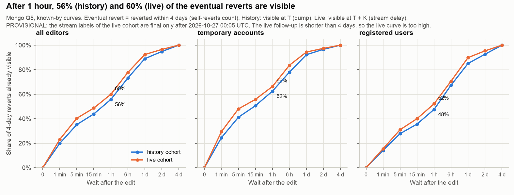

*Figure file: `results/figures/fig_known_by_curves.png`.* [OWNER: write the caption in your own words.]

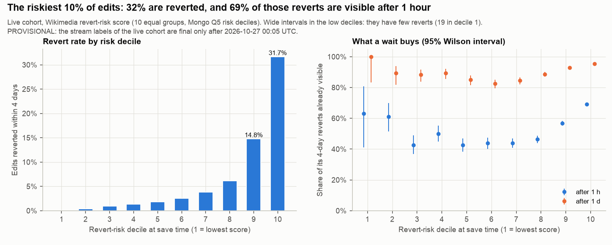

*Figure file: `results/figures/fig_risk_deciles.png`.* [OWNER: write the caption in your own words.]

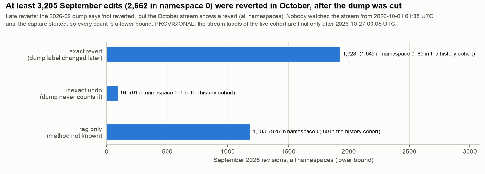

*Figure file: `results/figures/fig_late_reverts.png`.* [OWNER: write the caption in your own words.]

[OWNER: describe ONE persona in 2-3 sentences: a RAG-crawler engineer who copies Wikipedia pages into a search index for an AI assistant. What does she lose if she copies an edit too early? What does each hour of waiting cost her?]

**The decision table** (live cohort, from notebook 05; PROVISIONAL until the live refresh) `[drafted by Claude Code; checked by <name>, <date>]`

"Visible after w" = the share of the group's reverts within 4 days that already happened by the wait w. "Reverted later if clean at w" = of the edits not reverted by w, the share that is still reverted within 4 days. Brackets: Wilson 95% interval.

| risk group   | risk score   | edits (n)   | reverts in 4 d (n)   | revert rate   | visible after 1 h [95% CI]   | visible after 1 d [95% CI]   | reverted later if clean at 1 h [95% CI]   | reverted later if clean at 1 d [95% CI]   |
|--------------|--------------|-------------|----------------------|---------------|------------------------------|------------------------------|-------------------------------------------|-------------------------------------------|
| decile 1     | 0.00-0.06    | 26,902      | 19                   | 0.07%         | 63.2% (41.0-80.9)            | 100.0% (83.2-100.0)          | 0.03% (0.01-0.05)                         | 0.00% (0.00-0.01)                         |
| decile 2     | 0.06-0.12    | 26,902      | 103                  | 0.38%         | 61.2% (51.5-70.0)            | 89.3% (81.9-93.9)            | 0.15% (0.11-0.20)                         | 0.04% (0.02-0.07)                         |
| decile 3     | 0.12-0.18    | 26,902      | 248                  | 0.92%         | 42.7% (36.7-49.0)            | 88.3% (83.7-91.7)            | 0.53% (0.45-0.62)                         | 0.11% (0.08-0.16)                         |
| decile 4     | 0.18-0.25    | 26,902      | 354                  | 1.32%         | 50.0% (44.8-55.2)            | 89.3% (85.6-92.1)            | 0.66% (0.57-0.77)                         | 0.14% (0.10-0.20)                         |
| decile 5     | 0.25-0.32    | 26,902      | 500                  | 1.86%         | 42.6% (38.3-47.0)            | 85.0% (81.6-87.9)            | 1.08% (0.96-1.21)                         | 0.28% (0.23-0.35)                         |
| decile 6     | 0.32-0.40    | 26,902      | 692                  | 2.57%         | 43.8% (40.1-47.5)            | 82.5% (79.5-85.2)            | 1.46% (1.33-1.61)                         | 0.46% (0.38-0.55)                         |
| decile 7     | 0.40-0.49    | 26,902      | 1,027                | 3.82%         | 43.8% (40.8-46.9)            | 84.4% (82.1-86.5)            | 2.18% (2.01-2.36)                         | 0.61% (0.53-0.72)                         |
| decile 8     | 0.49-0.63    | 26,902      | 1,662                | 6.18%         | 46.3% (43.9-48.7)            | 88.7% (87.1-90.1)            | 3.41% (3.20-3.64)                         | 0.74% (0.64-0.85)                         |
| decile 9     | 0.63-0.83    | 26,902      | 3,978                | 14.79%        | 56.8% (55.3-58.3)            | 92.9% (92.1-93.7)            | 6.97% (6.66-7.30)                         | 1.22% (1.08-1.36)                         |
| decile 10    | 0.83-1.00    | 26,898      | 8,517                | 31.66%        | 69.2% (68.2-70.2)            | 95.3% (94.8-95.7)            | 12.48% (12.04-12.93)                      | 2.13% (1.93-2.35)                         |
| no score     | none         | 10,450      | 159                  | 1.52%         | 49.1% (41.4-56.8)            | 88.7% (82.8-92.7)            | 0.78% (0.63-0.97)                         | 0.17% (0.11-0.28)                         |

The revert-risk score is Wikimedia's `revertrisk-language-agnostic` model: cite `report/references.md` W17. The "no score" group holds page creations plus edits whose score event was not captured.

**Guiding questions**
1. For the riskiest edits, how much does waiting 1 hour or 1 day help?
2. For the low-risk edits, is waiting worth it?
3. What do the late reverts (`late_reverts_*`) say about trusting the dump label?

[OWNER (Comparison+viz): write 3-6 short sentences in your own words, from the persona's point of view, with 2-3 numbers from the table.]

## Comparison top 5

**Owner:** Comparison+viz. **Words:** about 300.

**Facts box**

| key                       | value   | unit                                                               | status      |
|---------------------------|---------|--------------------------------------------------------------------|-------------|
| `cmp_loc_top_mongodb`     | 62      | lines (non-blank, non-comment)                                     | FINAL       |
| `cmp_loc_top_neo4j`       | 18      | lines (non-blank, non-comment)                                     | FINAL       |
| `cmp_loc_top_sqlite`      | 38      | lines (non-blank, non-comment)                                     | FINAL       |
| `cmp_loc_mutual_mongodb`  | 52      | lines (non-blank, non-comment)                                     | FINAL       |
| `cmp_loc_mutual_neo4j`    | 6       | lines (non-blank, non-comment)                                     | FINAL       |
| `cmp_loc_mutual_sqlite`   | 13      | lines (non-blank, non-comment)                                     | FINAL       |
| `cmp_ms_top_mongodb`      | 76.7    | ms (draft, median of 21 runs in 3 rounds)                          | PROVISIONAL |
| `cmp_ms_top_neo4j`        | 114.2   | ms (draft, median of 21 runs in 3 rounds)                          | PROVISIONAL |
| `cmp_ms_top_sqlite`       | 25.2    | ms (draft, median of 21 runs in 3 rounds)                          | PROVISIONAL |
| `cmp_ms_mutual_mongodb`   | 133.1   | ms (draft, median of 21 runs in 3 rounds)                          | PROVISIONAL |
| `cmp_ms_mutual_neo4j`     | 39.3    | ms (draft, median of 21 runs in 3 rounds)                          | PROVISIONAL |
| `cmp_ms_mutual_sqlite`    | 16.1    | ms (draft, median of 21 runs in 3 rounds)                          | PROVISIONAL |
| `cmp_pain_top_mongodb`    | 3       | of 5 (draft by Claude Code; the Comparison+viz owner re-scores it) | PROVISIONAL |
| `cmp_pain_top_neo4j`      | 3       | of 5 (draft by Claude Code; the Comparison+viz owner re-scores it) | PROVISIONAL |
| `cmp_pain_top_sqlite`     | 2       | of 5 (draft by Claude Code; the Comparison+viz owner re-scores it) | PROVISIONAL |
| `cmp_pain_mutual_mongodb` | 4       | of 5 (draft by Claude Code; the Comparison+viz owner re-scores it) | PROVISIONAL |
| `cmp_pain_mutual_neo4j`   | 2       | of 5 (draft by Claude Code; the Comparison+viz owner re-scores it) | PROVISIONAL |
| `cmp_pain_mutual_sqlite`  | 2       | of 5 (draft by Claude Code; the Comparison+viz owner re-scores it) | PROVISIONAL |
| `cmp_all_identical`       | yes     |                                                                    | FINAL       |
| `cmp_timing_label`        | draft   | draft timings are PROVISIONAL                                      | PROVISIONAL |

**Figures:**

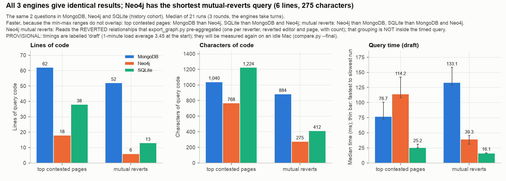

*Figure file: `results/figures/fig_comparison.png`.* [OWNER: write the caption in your own words.]

The candidate findings (numbers only) are in `results/comparison.md`, section "Candidate findings for 'Comparison top 5'".

The `cmp_pain_*` scores are **drafts by Claude Code** (`comparison/pain.csv`). The Comparison+viz owner re-scores them from their own experience and writes their name in the `scored_by` column. Only then are they the team's judgment.

| # | Finding (in your own words) | Number | Evidence file |
|---|---|---|---|
| 1 | [OWNER] | | |
| 2 | [OWNER] | | |
| 3 | [OWNER] | | |
| 4 | [OWNER] | | |
| 5 | [OWNER] | | |

**Guiding questions**
1. In which engine was each question easiest to write, and why (lines of code, modeling pain)?
2. Are the speed differences big enough to matter, and what do the times include (network hop, Docker)? (Call an engine faster only when the min-max ranges do not overlap. The Neo4j mutual-reverts time does not include the aggregation that `export_graph.py` does before the load.)
3. Which modeling choice made a query easy or hard (for example `page_id` on REVERTED)?

[OWNER: write the 5 findings in your own words, one or two sentences each. Use the final timings (after `compare.py --final`), not the draft ones.]

## Technical difficulties

**Owner:** Report+GenAI, with everyone's notes from `PROGRESS.md` ("Personal observations"). **Words:** about 250.

**Facts box**

| key                                    | value   | unit                                           | status      |
|----------------------------------------|---------|------------------------------------------------|-------------|
| `capture_page_change_files_cut_short`  | 11      | of 144 files                                   | PROVISIONAL |
| `capture_tags_files_cut_short`         | 27      | of 201 files                                   | PROVISIONAL |
| `capture_revert_risk_gaps`             | 2       | gaps over 120 s                                | PROVISIONAL |
| `capture_revert_risk_gap_s_total`      | 546     | s                                              | PROVISIONAL |
| `history_dropped_null_comment`         | 715     | rows                                           | FINAL       |
| `live_revert_events`                   | 29,112  | revert events (all namespaces)                 | PROVISIONAL |
| `live_revert_events_newest_not_parent` | 1,254   | revert events                                  | PROVISIONAL |
| `history_tag_share_T_7d_20d_pct`       | 79.37   | % with mw-reverted tag                         | FINAL       |
| `live_tag_confirmed_range_gt_15_pct`   | 0.00    | % of reverted revisions (complete ranges only) | PROVISIONAL |
| `live_followup_max_d`                  | 4.33    | days                                           | PROVISIONAL |

**Figures:**

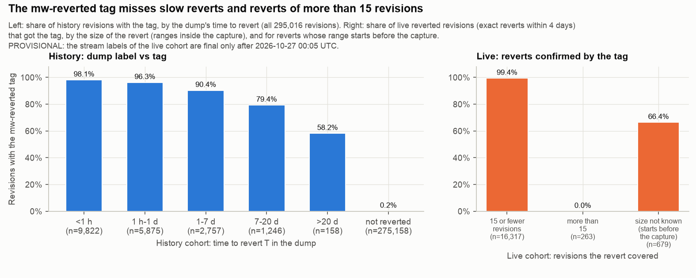

*Figure file: `results/figures/fig_tag_agreement.png`.* [OWNER: write the caption in your own words.]

**Guiding questions**
1. What broke or surprised us (for example: gzip files cut short, dump columns that are all text, page moves that look like edits, the stream and the dump defining a revert differently)?
2. How did we check that the three databases give the same answer?
3. What would we do earlier next time?

[OWNER: write 3-6 short sentences per difficulty (2-4 difficulties), in your own words, from the team's notes.]

## Best practices + key learnings

**Owner:** Report+GenAI, with everyone's notes. **Words:** about 250.

**Facts box**

| key                 | value    | unit                       | status   |
|---------------------|----------|----------------------------|----------|
| `cmp_all_identical` | yes      |                            | FINAL    |
| `mongo_indexes`     | 7        | indexes                    | FINAL    |
| `shard_checks_ok`   | 12 of 12 | checks                     | FINAL    |
| `atlas_estimate_mb` | 229.7    | MB (budget 400, limit 512) | FINAL    |

**Guiding questions**
1. Which rules kept the work safe and repeatable (never `rsync --delete`, write a `.tmp` file and then rename it, one `config.py` for every rule)?
2. What did each of us learn about document modeling compared with graph modeling?
3. What advice would you give a team that starts this homework tomorrow?

[OWNER: write 4-6 short bullet points in your own words. Each member adds at least one.]

## Criteria map table

**Owner:** Report+GenAI (check every file link). `[drafted by Claude Code; checked by <name>, <date>]`

| Criterion (spec section 8) | Evidence (file or figure) | As in spec / changed |
|---|---|---|
| Meaningful goal | Motivation; `report/FACTS.md` (`example_*`, `history_*`); notebook `05_truth_lag.ipynb` | as in spec (revert + Truth Lag framing) |
| Workflow | `report/figures/architecture.png`; `ec-hw2/README.md` section 1; `ingest/`, `load_mongo.py`, `export_graph.py`, `load_neo4j.py`, `queries/` | changed: VPS capture + rsync, `page_change.v1` (see "Where we differ from the spec") |
| Innovation | Mongo Q5 (`queries/mongo/q5_truth_lag_preview.json`, `results/mongo_q5_*.csv`); `fig_known_by_curves.png`, `fig_risk_deciles.png`; late-revert case study (`fig_late_reverts.png`); revert graph (Cypher Q1-Q5) | changed: two cohorts + Wikimedia's live revert-risk score |
| Technical difficulty | stream labels (`ingest/label_live.py`, range cover), dump labels (`ingest/parse_history.py`, reverter self-join), two databases + SQLite, GDS PageRank / Louvain / WCC (`queries/cypher/q2_*.cypher`, `q3_*.cypher`), `fig_tag_agreement.png` | changed: the stream + dump join is the late-revert case study (the October dump comes in November) |
| Queries/aggregations | `queries/mongo/q1-q5*.json` + `results/mongo_q*.md`; `queries/cypher/q1-q5*.cypher` + `results/cypher_q*.md`; notebooks 02 and 03 | as in spec (5 + 5) |
| Scale-out | `scaleout/SHARDING.md`, `results/sharding.md`; `load_mongo.py --target atlas`; Atlas screenshots in `results/figures/`: `atlas_cluster_m0.png` (the M0 free tier), `atlas_indexes.png`, `atlas_sample_document.png`, `atlas_mongo_q1.png` to `atlas_mongo_q4.png`; Mongo Q5 on the local MongoDB: `mongo_q5_local.png` | changed: Atlas M0 cannot shard, so a local 2-shard cluster shows the shard key |
| Programming | Python scripts in `ec-hw2/` (PyMongo, neo4j driver), Cypher files, tests in `ec-hw2/tests/` | as in spec |
| Visualization | Atlas Charts PNGs (`results/figures/chart_q1_hour_kind.png`, `chart_q3_time_to_revert.png`); Neo4j Browser screenshots in `results/figures/`: `neo4j_schema.png`, `neo4j_mutual_reverts.png`, `neo4j_contested_page.png`, `neo4j_largest_community.png`, `neo4j_cypher_q1_table.png` to `neo4j_cypher_q5_table.png`; `results/figures/fig_*.png`; `neo4j_edit_war_example.png` | changed: Neo4j Browser instead of Bloom |
| Comparison | `results/comparison.md`, `comparison/compare.py`, notebook `04_comparison.ipynb`, `fig_comparison.png` | as in spec (SQLite as the SQL engine) |
| Bonus | `ec-hw2/docker-compose.yml`, `scaleout/docker-compose.sharded.yml`; LLM use documented in `genai/PROMPTS.md` and `genai/prompts/`; blog or video: [OWNER: yes or no] | as in spec |

## Reuse note

**Owner:** Report+GenAI. **Words:** about 120. `[drafted by Claude Code; checked by <name>, <date>]`

HW2 is the storage and query MVP of our course project (Truth Lag). These parts carry over:

| HW2 part | File | Use in the final project |
|---|---|---|
| Live capture | `ingest/vps/capture.py` (repo root), `truthlag-capture-a` / `-b` | [OWNER] |
| Parsers | `ingest/parse_stream.py`, `ingest/parse_history.py`, `ingest/history_columns.py` | [OWNER] |
| Labels | `ingest/label_live.py` (range cover, 4-day label), `ingest/late_reverts.py` | [OWNER] |
| `revert_links` | `DATA_MODEL.md` section 3; MongoDB collection `revert_links` | [OWNER] |
| `page_hour` | `speed_layer.py`; MongoDB collection `page_hour` | [OWNER] |

Kafka and Spark come in the final project. HW2 does not use them.

[OWNER: write 2-4 short sentences in your own words: what we reuse, and what we add in the final project.]

## Mandatory GenAI Q&A

**Owner:** Report+GenAI; every member fills in their own row. `[drafted by Claude Code; checked by <name>, <date>]`

**Course question:** "Did you find or come across solutions to similar problems by using Generative AI or other sources?"

**Answer:** Yes.

[OWNER: write 2-4 short sentences in your own words: which tools we used, for what, and how people checked the output. Then answer the question itself: which solutions to similar problems we found, through AI or other sources (for example [6], [14], [P3] ORES, and Wikimedia's daily history table T424350, facts W13-W16 in report/references.md), and say that we reuse no code from them.]

| Spec item # | Tool + exact model ID | Verbatim prompt or link | Help given | What a person checked |
|---|---|---|---|---|
| Planning (all items) | Claude Code, `claude-opus-5-5` | `ec-hw2/genai/PROMPTS.md`, `ec-hw2/genai/APPROVED_PLAN.md` | Drafted the plan; Scott Nelson approved it after 3 rounds of changes | [OWNER] |
| 2 Data (VPS capture and filter) | Claude Code, `claude-opus-5-5` | Made in an earlier Claude Code session directed by Scott; prompts not kept (`ec-hw2/genai/PROMPTS.md`) | Drafted `ingest/vps/capture.py`, the systemd units and `filter_history.py` | [OWNER] |
| 2 Data, 6 Engineering | Claude Code, `claude-opus-5-5` | `ec-hw2/genai/prompts/build_history.md`, `build_stream.md` | Drafted the parse scripts and the stream labels | [OWNER] |
| 3 MongoDB (Mongo Q1-Q5) | Claude Code, `claude-opus-5-5` | `ec-hw2/genai/prompts/build_mongo.md` | Drafted the 5 aggregation pipelines, `load_mongo.py`, `speed_layer.py` | [OWNER] |
| 3 Scale-out | Claude Code, `claude-opus-5-5` | `ec-hw2/genai/prompts/build_scaleout.md` | Drafted the 2-shard demo and `SHARDING.md` | [OWNER] |
| 4 Neo4j (Cypher Q1-Q5) | Claude Code, `claude-opus-5-5` | `ec-hw2/genai/prompts/build_neo4j.md` | Drafted the 5 Cypher queries, `export_graph.py`, `load_neo4j.py` | [OWNER] |
| 5 Comparison | Claude Code, `claude-opus-5-5` | `ec-hw2/genai/prompts/build_comparison.md` | Drafted the SQL queries, `load_sql.py`, `compare.py` | [OWNER] |
| 7 Report: literature | Claude Code, `claude-opus-5-5` | `ec-hw2/genai/prompts/build_literature.md` | Suggested the candidate list of papers, followed reference lists, checked each DOI on Crossref and read the abstracts | [OWNER: which papers a person opened and read, and what they found] |
| 7 Report: docs | Claude Code, `claude-opus-5-5` | `ec-hw2/genai/prompts/build_docs.md`, `build_notebooks.md` | Drafted the docs, notebooks, `FACTS.md` and this skeleton (no narrative) | [OWNER] |
| Review (all items) | Claude Code Workflow, `claude-opus-5-5` | `ec-hw2/genai/workflows/verify.js`, `ec-hw2/genai/prompts/verify_*.md` | 7 independent AI reviewers tried to refute the build and listed findings | [OWNER] |
| Fixes after the review (all items) | Claude Code, `claude-opus-5-5` | `ec-hw2/genai/prompts/fix_common.md` and `fix_*.md` | Fixed the confirmed findings (see `ec-hw2/genai/PROMPTS.md`, "Errors the review caught") | [OWNER] |
| 5 Comparison: modeling pain | Claude Code, `claude-opus-5-5` (draft only) | `comparison/pain.csv` | Draft pain scores and reasons | [OWNER (Comparison+viz): your own scores, and what you changed] |
| [OWNER: item #] | [Scott Nelson: tool + model, or "none"] | | | |
| [OWNER: item #] | [Tingyu Lee: tool + model, or "none"] | | | |
| [OWNER: item #] | [Wanru Hsiao: tool + model, or "none"] | | | |
| [OWNER: item #] | [Zhenni Dai: tool + model, or "none"] | | | |

Translators and grammar tools count as AI tools: list them too.

**Errors that review caught**

The errors that the AI review found, and the fixes, are listed in `ec-hw2/genai/PROMPTS.md`, section "Errors the review caught (2026-10-24)". Add the errors that people found below.

| Error | Found by (person or check) | How it was fixed | Evidence (file, commit or PR comment) |
|---|---|---|---|
| [OWNER] | | | |
| [OWNER] | | | |
| [OWNER] | | | |

**Who did what** (verbs: built, verified, created in UI, wrote)

| Member | Built | Verified | Created in UI | Wrote | AI tools used (or none) |
|---|---|---|---|---|---|
| Scott Nelson | | | | | |
| Tingyu Lee | | | | | |
| Wanru Hsiao | | | | | |
| Zhenni Dai | | | | | |

### Appendix: the long Mongo pipelines (Mongo Q3 and Q5)

`[drafted by Claude Code; checked by <name>, <date>]` In the Google Doc, put this appendix after the last section. The Mongo section links here.

**Mongo Q3: time to revert ($bucket on the lag grid)**

Collection `revert_links`. File `queries/mongo/q3_time_to_revert.json`. Median time 50.3 ms (median of 7), local MongoDB.

```json
[
    {"$match": {"cohort": {"$in": ["history", "live"]}, "within_followup": true}},
    {
      "$facet": {
        "history": [
          {"$match": {"cohort": "history"}},
          {
            "$bucket": {
              "groupBy": "$T_s",
              "boundaries": [
                0,
                60,
                300,
                900,
                3600,
                21600,
                86400,
                172800,
                345600,
                604800,
                1209600,
                1728001
              ],
              "default": "over_20d",
              "output": {"n": {"$sum": 1}}
            }
          }
        ],
        "live": [
          {"$match": {"cohort": "live"}},
          {
            "$bucket": {
              "groupBy": "$T_s",
              "boundaries": [
                0,
                60,
                300,
                900,
                3600,
                21600,
                86400,
                172800,
                345600,
                604800,
                1209600,
                1728001
              ],
              "default": "over_20d",
              "output": {"n": {"$sum": 1}}
            }
          }
        ],
        "history_4d": [
          {"$match": {"cohort": "history", "T_s": {"$lte": 345600}}},
          {
            "$bucket": {
              "groupBy": "$T_s",
              "boundaries": [
                0,
                60,
                300,
                900,
                3600,
                21600,
                86400,
                172800,
                345600,
                604800,
                1209600,
                1728001
              ],
              "default": "over_20d",
              "output": {"n": {"$sum": 1}}
            }
          }
        ]
      }
    },
    {
      "$project": {
        "rows": {
          "$concatArrays": [
            {
              "$map": {
                "input": "$history",
                "in": {"cohort": "history", "bucket_lower_s": "$$this._id", "n": "$$this.n"}
              }
            },
            {
              "$map": {
                "input": "$live",
                "in": {"cohort": "live", "bucket_lower_s": "$$this._id", "n": "$$this.n"}
              }
            },
            {
              "$map": {
                "input": "$history_4d",
                "in": {"cohort": "history_4d", "bucket_lower_s": "$$this._id", "n": "$$this.n"}
              }
            }
          ]
        }
      }
    },
    {"$unwind": "$rows"},
    {"$replaceRoot": {"newRoot": "$rows"}},
    {
      "$setWindowFields": {
        "partitionBy": "$cohort",
        "sortBy": {"bucket_lower_s": 1},
        "output": {
          "total": {"$sum": "$n", "window": {"documents": ["unbounded", "unbounded"]}},
          "cum_n": {"$sum": "$n", "window": {"documents": ["unbounded", "current"]}}
        }
      }
    },
    {
      "$project": {
        "_id": 0,
        "cohort": 1,
        "bucket": {
          "$cond": [
            {"$eq": ["$bucket_lower_s", "over_20d"]},
            "over_20d",
            {
              "$arrayElemAt": [
                [
                  "<1 min",
                  "1-5 min",
                  "5-15 min",
                  "15-60 min",
                  "1-6 h",
                  "6-24 h",
                  "1-2 d",
                  "2-4 d",
                  "4-7 d",
                  "7-14 d",
                  "14-20 d"
                ],
                {
                  "$indexOfArray": [
                    [0, 60, 300, 900, 3600, 21600, 86400, 172800, 345600, 604800, 1209600, 1728001],
                    "$bucket_lower_s"
                  ]
                }
              ]
            }
          ]
        },
        "bucket_lower_s": 1,
        "bucket_order": {
          "$add": [
            {
              "$indexOfArray": [
                [0, 60, 300, 900, 3600, 21600, 86400, 172800, 345600, 604800, 1209600, 1728001],
                "$bucket_lower_s"
              ]
            },
            1
          ]
        },
        "bucket_sorted": {
          "$concat": [
            {
              "$cond": [
                {
                  "$lt": [
                    {
                      "$add": [
                        {
                          "$indexOfArray": [
                            [
                              0,
                              60,
                              300,
                              900,
                              3600,
                              21600,
                              86400,
                              172800,
                              345600,
                              604800,
                              1209600,
                              1728001
                            ],
                            "$bucket_lower_s"
                          ]
                        },
                        1
                      ]
                    },
                    10
                  ]
                },
                "0",
                ""
              ]
            },
            {
              "$toString": {
                "$add": [
                  {
                    "$indexOfArray": [
                      [
                        0,
                        60,
                        300,
                        900,
                        3600,
                        21600,
                        86400,
                        172800,
                        345600,
                        604800,
                        1209600,
                        1728001
                      ],
                      "$bucket_lower_s"
                    ]
                  },
                  1
                ]
              }
            },
            " ",
            {
              "$cond": [
                {"$eq": ["$bucket_lower_s", "over_20d"]},
                "over_20d",
                {
                  "$arrayElemAt": [
                    [
                      "<1 min",
                      "1-5 min",
                      "5-15 min",
                      "15-60 min",
                      "1-6 h",
                      "6-24 h",
                      "1-2 d",
                      "2-4 d",
                      "4-7 d",
                      "7-14 d",
                      "14-20 d"
                    ],
                    {
                      "$indexOfArray": [
                        [
                          0,
                          60,
                          300,
                          900,
                          3600,
                          21600,
                          86400,
                          172800,
                          345600,
                          604800,
                          1209600,
                          1728001
                        ],
                        "$bucket_lower_s"
                      ]
                    }
                  ]
                }
              ]
            }
          ]
        },
        "bucket_upper_s": {
          "$arrayElemAt": [
            [0, 60, 300, 900, 3600, 21600, 86400, 172800, 345600, 604800, 1209600, 1728001],
            {
              "$add": [
                {
                  "$indexOfArray": [
                    [0, 60, 300, 900, 3600, 21600, 86400, 172800, 345600, 604800, 1209600, 1728001],
                    "$bucket_lower_s"
                  ]
                },
                1
              ]
            }
          ]
        },
        "n": 1,
        "share": {"$divide": ["$n", "$total"]},
        "cum_share": {"$divide": ["$cum_n", "$total"]}
      }
    },
    {"$sort": {"cohort": 1, "bucket_lower_s": 1}}
  ]
```

Result: the first rows (of 27 rows in `results/mongo_q3_time_to_revert.csv`):

| cohort     | bucket    | bucket_lower_s   | bucket_upper_s   | n    | share   | cum_share   | bucket_order   | bucket_sorted   |
|------------|-----------|------------------|------------------|------|---------|-------------|----------------|-----------------|
| history    | <1 min    | 0                | 60               | 3470 | 0.1761  | 0.1761      | 1              | 01 <1 min       |
| history    | 1-5 min   | 60               | 300              | 2722 | 0.1382  | 0.3143      | 2              | 02 1-5 min      |
| history    | 5-15 min  | 300              | 900              | 1542 | 0.07827 | 0.3926      | 3              | 03 5-15 min     |
| history    | 15-60 min | 900              | 3600             | 2088 | 0.106   | 0.4986      | 4              | 04 15-60 min    |
| history    | 1-6 h     | 3600             | 21600            | 3078 | 0.1562  | 0.6548      | 5              | 05 1-6 h        |
| history    | 6-24 h    | 21600            | 86400            | 2797 | 0.142   | 0.7968      | 6              | 06 6-24 h       |
| history    | 1-2 d     | 86400            | 172800           | 1028 | 0.05218 | 0.849       | 7              | 07 1-2 d        |
| history    | 2-4 d     | 172800           | 345600           | 921  | 0.04675 | 0.8957      | 8              | 08 2-4 d        |
| history    | 4-7 d     | 345600           | 604800           | 808  | 0.04102 | 0.9368      | 9              | 09 4-7 d        |
| history    | 7-14 d    | 604800           | 1209600          | 852  | 0.04325 | 0.98        | 10             | 10 7-14 d       |
| history    | 14-20 d   | 1209600          | 1728001          | 394  | 0.02    | 1           | 11             | 11 14-20 d      |
| history_4d | <1 min    | 0                | 60               | 3470 | 0.1966  | 0.1966      | 1              | 01 <1 min       |
| history_4d | 1-5 min   | 60               | 300              | 2722 | 0.1543  | 0.3509      | 2              | 02 1-5 min      |
| history_4d | 5-15 min  | 300              | 900              | 1542 | 0.08739 | 0.4383      | 3              | 03 5-15 min     |
| history_4d | 15-60 min | 900              | 3600             | 2088 | 0.1183  | 0.5566      | 4              | 04 15-60 min    |
| history_4d | 1-6 h     | 3600             | 21600            | 3078 | 0.1744  | 0.731       | 5              | 05 1-6 h        |
| history_4d | 6-24 h    | 21600            | 86400            | 2797 | 0.1585  | 0.8896      | 6              | 06 6-24 h       |
| history_4d | 1-2 d     | 86400            | 172800           | 1028 | 0.05826 | 0.9478      | 7              | 07 1-2 d        |
| history_4d | 2-4 d     | 172800           | 345600           | 921  | 0.05219 | 1           | 8              | 08 2-4 d        |
| live       | <1 min    | 0                | 60               | 4148 | 0.2403  | 0.2403      | 1              | 01 <1 min       |
| live       | 1-5 min   | 60               | 300              | 2830 | 0.164   | 0.4043      | 2              | 02 1-5 min      |
| live       | 5-15 min  | 300              | 900              | 1428 | 0.08274 | 0.4871      | 3              | 03 5-15 min     |
| live       | 15-60 min | 900              | 3600             | 1923 | 0.1114  | 0.5985      | 4              | 04 15-60 min    |
| live       | 1-6 h     | 3600             | 21600            | 3076 | 0.1782  | 0.7767      | 5              | 05 1-6 h        |
| live       | 6-24 h    | 21600            | 86400            | 2532 | 0.1467  | 0.9234      | 6              | 06 6-24 h       |
| live       | 1-2 d     | 86400            | 172800           | 716  | 0.04149 | 0.9649      | 7              | 07 1-2 d        |
| live       | 2-4 d     | 172800           | 345600           | 606  | 0.03511 | 1           | 8              | 08 2-4 d        |

**Mongo Q5: truth-lag preview (share of eventual reverts known after a wait)**

Collection `revisions`. File `queries/mongo/q5_truth_lag_preview.json`. Median time 15,147.8 ms (median of 7), local MongoDB.

```json
[
    {"$match": {"cohort": {"$in": ["history", "live"]}}},
    {
      "$lookup": {
        "from": "revert_links",
        "localField": "rev_id",
        "foreignField": "reverted_rev_id",
        "let": {"c": "$cohort"},
        "pipeline": [
          {"$match": {"$expr": {"$eq": ["$cohort", "$$c"]}}},
          {"$project": {"_id": 0, "T_s": 1, "K_s": 1}}
        ],
        "as": "link"
      }
    },
    {
      "$addFields": {
        "prev_hour_key": {
          "$cond": [
            {"$eq": ["$cohort", "live"]},
            {
              "$concat": [
                {"$toString": "$page.id"},
                ":",
                {
                  "$dateToString": {
                    "date": {
                      "$dateSubtract": {"startDate": "$live.seen_ts", "unit": "hour", "amount": 1}
                    },
                    "format": "%Y-%m-%dT%H",
                    "timezone": "UTC"
                  }
                }
              ]
            },
            null
          ]
        }
      }
    },
    {
      "$lookup": {
        "from": "page_hour",
        "localField": "prev_hour_key",
        "foreignField": "_id",
        "as": "prev_hour"
      }
    },
    {
      "$project": {
        "_id": 0,
        "cohort": 1,
        "user_kind": "$user.kind",
        "risk": "$live.revert_risk",
        "T": {"$first": "$link.T_s"},
        "K": {"$first": "$link.K_s"},
        "prev_clock_hour": {
          "$cond": [
            {"$eq": ["$cohort", "live"]},
            {"$ifNull": [{"$first": "$prev_hour.edits_seen"}, 0]},
            null
          ]
        },
        "prev_1h": {"$ifNull": ["$live.page_edits_prev_1h", "$history.page_edits_prev_1h"]}
      }
    },
    {
      "$addFields": {
        "rev_4d": {"$and": [{"$gte": ["$T", 0]}, {"$lte": ["$T", 345600]}]},
        "known_by": {"$add": ["$T", {"$ifNull": ["$K", 0]}]}
      }
    },
    {
      "$facet": {
        "known_by": [
          {"$addFields": {"kinds": ["$user_kind", "all"]}},
          {"$unwind": "$kinds"},
          {
            "$group": {
              "_id": {"cohort": "$cohort", "user_kind": "$kinds"},
              "n_edits": {"$sum": 1},
              "n_reverted_4d": {"$sum": {"$cond": ["$rev_4d", 1, 0]}},
              "known_0": {
                "$sum": {"$cond": [{"$and": ["$rev_4d", {"$lte": ["$known_by", 0]}]}, 1, 0]}
              },
              "known_1": {
                "$sum": {"$cond": [{"$and": ["$rev_4d", {"$lte": ["$known_by", 60]}]}, 1, 0]}
              },
              "known_2": {
                "$sum": {"$cond": [{"$and": ["$rev_4d", {"$lte": ["$known_by", 300]}]}, 1, 0]}
              },
              "known_3": {
                "$sum": {"$cond": [{"$and": ["$rev_4d", {"$lte": ["$known_by", 900]}]}, 1, 0]}
              },
              "known_4": {
                "$sum": {"$cond": [{"$and": ["$rev_4d", {"$lte": ["$known_by", 3600]}]}, 1, 0]}
              },
              "known_5": {
                "$sum": {"$cond": [{"$and": ["$rev_4d", {"$lte": ["$known_by", 21600]}]}, 1, 0]}
              },
              "known_6": {
                "$sum": {"$cond": [{"$and": ["$rev_4d", {"$lte": ["$known_by", 86400]}]}, 1, 0]}
              },
              "known_7": {
                "$sum": {"$cond": [{"$and": ["$rev_4d", {"$lte": ["$known_by", 172800]}]}, 1, 0]}
              },
              "known_8": {
                "$sum": {"$cond": [{"$and": ["$rev_4d", {"$lte": ["$known_by", 345600]}]}, 1, 0]}
              }
            }
          },
          {"$match": {"n_reverted_4d": {"$gte": 100}}},
          {
            "$project": {
              "_id": 0,
              "cohort": "$_id.cohort",
              "user_kind": "$_id.user_kind",
              "n_edits": 1,
              "n_reverted_4d": 1,
              "waits": [
                {"wait": "0", "wait_s": 0, "wait_sorted": "01 0", "known": "$known_0"},
                {"wait": "1 min", "wait_s": 60, "wait_sorted": "02 1 min", "known": "$known_1"},
                {"wait": "5 min", "wait_s": 300, "wait_sorted": "03 5 min", "known": "$known_2"},
                {"wait": "15 min", "wait_s": 900, "wait_sorted": "04 15 min", "known": "$known_3"},
                {"wait": "1 h", "wait_s": 3600, "wait_sorted": "05 1 h", "known": "$known_4"},
                {"wait": "6 h", "wait_s": 21600, "wait_sorted": "06 6 h", "known": "$known_5"},
                {"wait": "1 d", "wait_s": 86400, "wait_sorted": "07 1 d", "known": "$known_6"},
                {"wait": "2 d", "wait_s": 172800, "wait_sorted": "08 2 d", "known": "$known_7"},
                {"wait": "4 d", "wait_s": 345600, "wait_sorted": "09 4 d", "known": "$known_8"}
              ]
            }
          },
          {"$unwind": "$waits"},
          {
            "$project": {
              "cohort": 1,
              "user_kind": 1,
              "wait": "$waits.wait",
              "wait_s": "$waits.wait_s",
              "wait_sorted": "$waits.wait_sorted",
              "n_edits": 1,
              "n_reverted_4d": 1,
              "revert_rate_4d": {"$divide": ["$n_reverted_4d", "$n_edits"]},
              "known": "$waits.known",
              "share_known": {"$divide": ["$waits.known", "$n_reverted_4d"]}
            }
          },
          {"$sort": {"cohort": 1, "user_kind": 1, "wait_s": 1}}
        ],
        "activity": [
          {
            "$project": {
              "cohort": 1,
              "rev_4d": 1,
              "measure": {
                "$cond": [
                  {"$eq": ["$cohort", "live"]},
                  [
                    {"source": "page_hour", "edits": "$prev_clock_hour"},
                    {"source": "prev_1h", "edits": "$prev_1h"}
                  ],
                  [{"source": "prev_1h", "edits": "$prev_1h"}]
                ]
              }
            }
          },
          {"$unwind": "$measure"},
          {
            "$group": {
              "_id": {
                "cohort": "$cohort",
                "source": "$measure.source",
                "edge": {
                  "$switch": {
                    "branches": [
                      {"case": {"$lt": ["$measure.edits", 1]}, "then": 0},
                      {"case": {"$lt": ["$measure.edits", 2]}, "then": 1},
                      {"case": {"$lt": ["$measure.edits", 5]}, "then": 2},
                      {"case": {"$lt": ["$measure.edits", 10]}, "then": 5}
                    ],
                    "default": 10
                  }
                }
              },
              "n_edits": {"$sum": 1},
              "n_reverted_4d": {"$sum": {"$cond": ["$rev_4d", 1, 0]}}
            }
          },
          {"$match": {"n_edits": {"$gte": 100}}},
          {
            "$project": {
              "_id": 0,
              "cohort": "$_id.cohort",
              "source": "$_id.source",
              "prev_hour_edits": {
                "$arrayElemAt": [
                  ["0", "1", "2-4", "5-9", "10+"],
                  {"$indexOfArray": [[0, 1, 2, 5, 10], "$_id.edge"]}
                ]
              },
              "prev_hour_edits_from": "$_id.edge",
              "n_edits": 1,
              "n_reverted_4d": 1,
              "revert_rate_4d": {"$divide": ["$n_reverted_4d", "$n_edits"]}
            }
          },
          {"$sort": {"cohort": 1, "source": 1, "prev_hour_edits_from": 1}}
        ]
      }
    }
  ]
```

Result: the first rows where user_kind=all; wait=1 min,1 h,1 d (of 72 rows in `results/mongo_q5_truth_lag_preview.csv`):

| cohort   | user_kind   | wait   | wait_s   | n_edits   | n_reverted_4d   | revert_rate_4d   | known   | share_known   | wait_sorted   |
|----------|-------------|--------|----------|-----------|-----------------|------------------|---------|---------------|---------------|
| history  | all         | 1 min  | 60       | 295016    | 17646           | 0.05981          | 3506    | 0.1987        | 02 1 min      |
| history  | all         | 1 h    | 3600     | 295016    | 17646           | 0.05981          | 9822    | 0.5566        | 05 1 h        |
| history  | all         | 1 d    | 86400    | 295016    | 17646           | 0.05981          | 15697   | 0.8896        | 07 1 d        |
| live     | all         | 1 min  | 60       | 279466    | 17259           | 0.06176          | 3986    | 0.231         | 02 1 min      |
| live     | all         | 1 h    | 3600     | 279466    | 17259           | 0.06176          | 10326   | 0.5983        | 05 1 h        |
| live     | all         | 1 d    | 86400    | 279466    | 17259           | 0.06176          | 15936   | 0.9233        | 07 1 d        |
